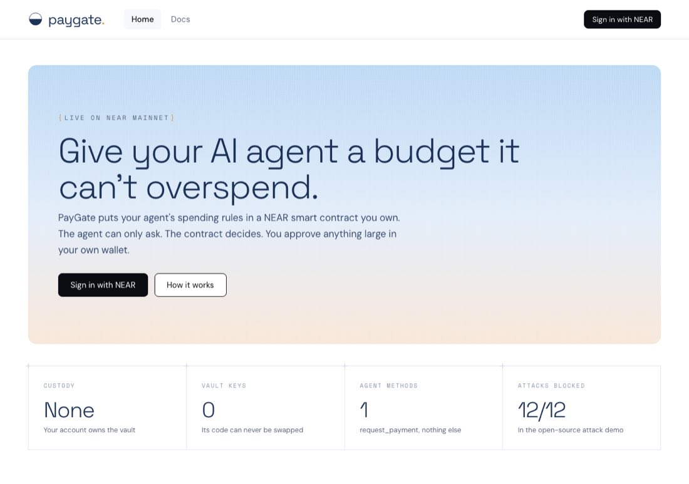
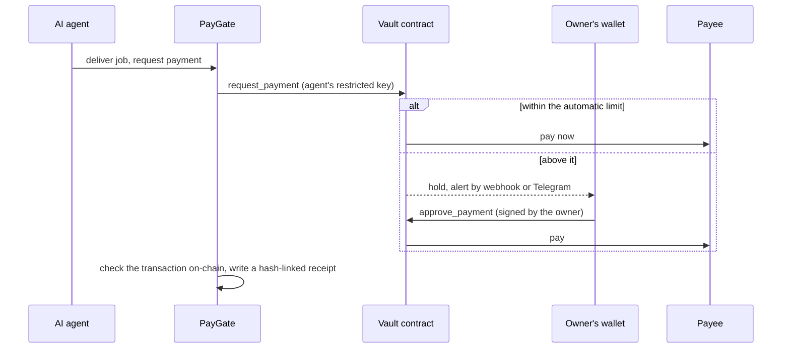
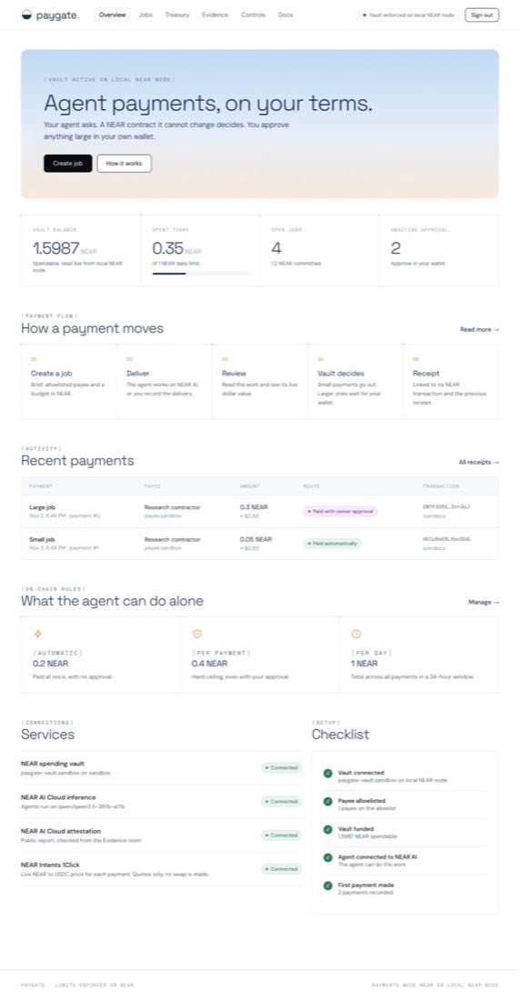
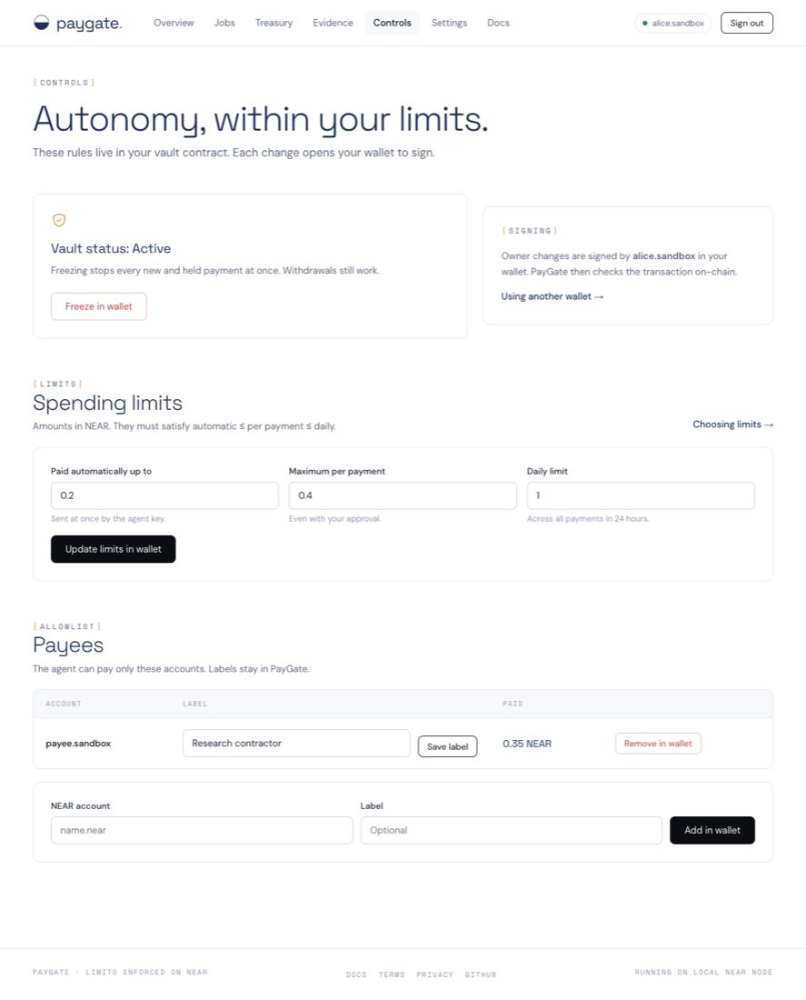
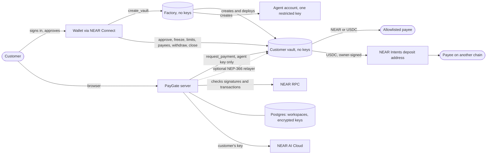
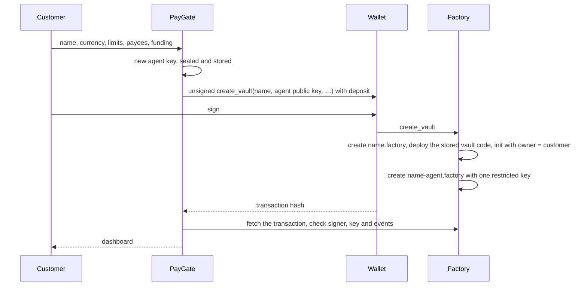

<div align="center">


# PayGate

**Give your AI agent a budget it can't overspend.**

Non-custodial spending vaults for AI agents on NEAR. The spending rules live in a smart contract the customer owns, so a hijacked agent cannot break them.

[**Live app (testnet)**](https://paygate-production-d611.up.railway.app) · [How it works](#how-it-works) · [NEAR technology](#near-technology-used) · [Architecture](#architecture) · [Quick start](#quick-start) · [Security](#security-model) · [Contracts](#contract-reference)

     



</div>

---

## At a glance

| | |
| --- | --- |
| **Problem** | An AI agent that can pay can be tricked into paying the wrong person. A single injected line in a document or job brief is enough. |
| **Solution** | A vault contract the customer owns holds the money. The agent's only key can *ask* the vault to pay; the vault decides by rules the agent cannot change: allowlisted payees, per-payment and daily limits, one payment per job, and owner approval for anything large. |
| **Proof** | An attack demo hijacks the agent and uses its real key to try 12 ways of stealing the funds. All 12 are blocked on-chain, and the attacker receives 0 NEAR ([log](docs/attack-demo-log.txt)). |
| **Built on NEAR** | Rust smart contracts, function-call access keys, NEP-413 sign-in, NEP-366 meta-transactions, NEP-141 and NEP-145 for USDC, NEP-297 events, NEAR Connect, NEAR AI Cloud, NEAR Intents 1Click and more. See [NEAR technology used](#near-technology-used). |
| **Status** | Public beta on NEAR testnet, with a separate mainnet deployment prepared. Contracts reviewed in-house ([docs/MAINNET.md](docs/MAINNET.md)); no independent audit yet. |

## Contents

1. [The problem](#the-problem)
2. [How it works](#how-it-works)
3. [NEAR technology used](#near-technology-used)
4. [Features](#features)
5. [Deployments and status](#deployments-and-status)
6. [Architecture](#architecture)
7. [Quick start](#quick-start)
8. [Using PayGate](#using-paygate)
9. [Agent API and MCP](#agent-api-and-mcp)
10. [Costs](#costs)
11. [Run your own PayGate](#run-your-own-paygate)
12. [Configuration](#configuration)
13. [Security model](#security-model)
14. [Contract reference](#contract-reference)
15. [HTTP API](#http-api)
16. [Testing and verification](#testing-and-verification)
17. [Project structure](#project-structure)
18. [Roadmap](#roadmap)
19. [Limitations](#limitations)
20. [Hackathon submission](#hackathon-submission)

---

## The problem

AI agents now pay for things: research, APIs, contractors, other agents. An agent that can pay can also be talked into paying an attacker. Prompt injection hides an instruction in content the agent reads, such as a web page, an email or a job brief.

The usual defences sit in the wrong place:

- **Rules in the prompt** can be argued away by the same injection.
- **Rules in the app** are bypassed by anyone who controls the app or steals the agent's key.
- **A custodial wallet** puts every customer's money in one operator's hands.

Once the agent is compromised, so is the budget.

## How it works

PayGate moves the rules to a place the agent cannot reach: a NEAR smart contract that the customer owns.

1. **Sign in with NEAR.** The customer's wallet signs a one-time message (NEP-413). PayGate checks the signature, and that the key is a full-access key of that account on-chain. There are no passwords.
2. **One transaction creates the vault.** The customer signs a single call to the PayGate factory. It creates a vault owned by the customer, with no keys of its own, and an agent account whose only key can call one method on that vault: `request_payment`.
3. **The agent asks; the contract decides.** The vault pays only allowlisted payees, within a per-payment and a daily limit, and pays each job once.
4. **The customer approves anything large.** Above the automatic limit, the vault holds the payment until the customer approves it in their own wallet. PayGate never holds an owner key.
5. **Everything leaves evidence.** Every payment has a NEAR transaction and a hash-linked receipt. Work done on NEAR AI Cloud keeps its signed response and attestation evidence.



## NEAR technology used

PayGate is built on NEAR end to end. Each item below is used in the shipped code, not only mentioned.

### Protocol and standards

| Technology | How PayGate uses it | Where |
| --- | --- | --- |
| **Rust smart contracts** ([near-sdk-rs](https://github.com/near/near-sdk-rs) 5.30) | The vault enforces every spending rule, and the factory creates vaults. Collections from `near_sdk::store`, promises and callbacks restore balances when a transfer fails | [contract/src/lib.rs](contract/src/lib.rs), [contract/factory/src/lib.rs](contract/factory/src/lib.rs) |
| **Function-call access keys with allowance** | The agent's only key can call `request_payment` on one vault, with a limited gas allowance. It cannot transfer, add keys or call owner methods. This is the core of the security model | factory `on_vault` |
| **Keyless accounts and sub-accounts** | The factory and every vault end with no access keys. Vaults are `name.factory` sub-accounts, so only the factory can create them | factory, `scripts/deploy-platform.mjs` |
| **Batched actions in one receipt** | Vault creation runs `CreateAccount`, `Transfer`, `DeployContract` and `FunctionCall(new)` together, so nobody can front-run initialization | factory `create_vault` |
| **Storage staking** | Each vault pays for its own code and state from the customer's deposit. `close()` uses `DeleteAccount` to return all of it to the owner | vault `close`, factory `vault_fund` |
| **One-yoctoNEAR guard** | Owner methods require 1 attached yoctoNEAR, which only a full-access key can send. A leaked function-call key cannot call them | vault `assert_owner` |
| **NEP-413** (signed messages) | Wallet sign-in: a nonce bound to the site, verified against the account's on-chain full-access keys | `chain.mjs` `verifySignIn`, `server.mjs` |
| **NEP-366** (meta-transactions) | Optional gas relayer. The agent signs a `DelegateAction`, and an operator account pays the gas. NEAR still enforces the agent key's method restriction | `chain.mjs` `relayed` |
| **NEP-141** (fungible tokens) | USDC vaults receive tokens through `ft_on_transfer` and pay with `ft_transfer`, counting only deposits from the vault's own token | vault |
| **NEP-145** (storage management) | `storage_deposit` registers the vault, payees and payout addresses with USDC | vault `pay_external`, server |
| **NEP-297** (events) | `payment_sent`, `payment_pending`, `payment_failed`, `vault_created` and other events. The server reads them to confirm outcomes | both contracts, `chain.mjs` |
| **Circle native USDC on NEAR** | Dollar budgets: `17208628…133a1` on mainnet, Circle's testnet USDC on testnet | `chain.mjs` `USDC` |

### NEAR products and tools

| Product | How PayGate uses it |
| --- | --- |
| **[NEAR Connect](https://www.npmjs.com/package/@hot-labs/near-connect)** (`@hot-labs/near-connect` 0.12) | The wallet selector: Meteor, HOT, Intear, Nightly, OKX, Ledger and more. Each wallet runs in a sandboxed iframe under a CSP with a nonce per response. It handles sign-in and every owner transaction |
| **[near-api-js](https://github.com/near/near-api-js)** 7 | The server builds wallet transactions, signs agent requests and meta-transactions, reads views and checks transaction outcomes on-chain |
| **[NEAR AI Cloud](https://docs.near.ai/cloud)** | Private inference with the customer's own API key. PayGate keeps the response signature with the receipt, and checks NEAR AI's Intel TDX attestation report (quote format, nonce binding, gateway measurement) in the Evidence room |
| **[NEAR Intents 1Click](https://docs.near-intents.org)** | Two uses. Dry quotes value each payment in dollars, with no swap. Live quotes pay USDC to Base, Arbitrum, Ethereum, Optimism, Polygon, Avalanche or Solana through an owner-signed payout to a one-time deposit address |
| **[near-sandbox](https://www.npmjs.com/package/near-sandbox)** (nearcore 2.14) | Runs a real local NEAR node for the end-to-end checks and the attack demo |
| **FastNEAR RPC** with the NEAR public RPC as fallback | Comma-separated RPC endpoints fail over to each other |
| **NearBlocks** | Explorer links on every receipt and transaction |
| **Shade Agents** (design only) | A design for moving the agent key into a TEE-attested worker: [docs/shade-agent-design.md](docs/shade-agent-design.md) |

## Features

| Area | What customers get |
| --- | --- |
| **Wallet sign-in** | NEP-413 sign-in through NEAR Connect, checked against on-chain full-access keys. Single-use nonces, bound to the site |
| **One-click vault** | A keyless factory creates the vault and its restricted agent from one signed transaction, and refunds the deposit if a step fails |
| **On-chain rules** | Payee allowlist; automatic, per-payment and daily limits; one payment per job; held payments; freeze; withdrawal that works while frozen |
| **Wallet approvals** | Approve, reject, freeze, change limits or payees, withdraw and close, each signed in the customer's wallet and confirmed on-chain. NEAR CLI and other wallets work by pasting the transaction hash |
| **Jobs workflow** | Create, deliver, review, pay or hold, approve or reject, cancel. Budgets are checked against the limits and against funds already committed |
| **USDC budgets** | Vaults can hold and pay Circle's native USDC, with limits in dollars. Deposits and payee registration take one click |
| **Cross-chain payouts** | USDC vaults pay addresses on seven other chains through NEAR Intents. The owner signs every payout, within the vault's limits; failed swaps refund to the owner. Mainnet only |
| **Agent API and MCP** | Scoped API keys let the customer's own agents read the vault, create and deliver jobs and request payment over REST or MCP. Agents can never approve, freeze, change rules or withdraw |
| **Bring your own AI** | The customer's NEAR AI Cloud key, stored encrypted, lets the agent do the work. The signed response is kept with the receipt |
| **Alerts** | Signed webhooks (Slack, Discord, any https endpoint) and Telegram for held payments, payments and deliveries |
| **Gas relayer** | Optional NEP-366 relayer: agents never run out of gas, and customers' deposits are 0.28 NEAR smaller |
| **Evidence** | Receipts with transaction links, SHA-256 hash-chain verification, JSON export and an attestation check |
| **Close and recover** | Owners can close an idle vault and get all of its NEAR back, including its storage |
| **Privacy** | Customers can delete their data at any time. Keys never reach the browser |

<table>
<tr>
<td width="50%"></td>
<td width="50%"></td>
</tr>
<tr>
<td align="center"><sub>Customer dashboard</sub></td>
<td align="center"><sub>Controls, each change signed in the wallet</sub></td>
</tr>
</table>

## Deployments and status

| Deployment | URL | Status |
| --- | --- | --- |
| Testnet public beta | https://paygate-production-d611.up.railway.app | Live, with testnet factory `paygate.drained99.testnet` |
| Mainnet | https://paygate-mainnet-production.up.railway.app | Server live; vault creation opens once the mainnet factory is deployed ([launch guide](docs/MAINNET.md)) |

| Part | What is real |
| --- | --- |
| Vault and factory contracts, agent key restriction, limits, allowlist, freeze | **Enforced by NEAR** |
| Payments | **Real NEAR or USDC**, sent to the payee's account |
| Sign-in and owner actions | **Signed in the customer's wallet.** PayGate never holds owner keys |
| Balance, daily spend, limits, held payments | **Read live** from the customer's vault |
| Dollar values and cross-chain payouts | **Live** NEAR Intents 1Click. Payouts run on mainnet only |
| NEAR AI Cloud inference and attestation | **Live** with the customer's own key. Intel's signature on the quote is not verified here; use the [NEAR AI Verification Center](https://docs.near.ai/cloud/verification/verification-center) |
| Independent security audit | **Not yet.** Customers are told to start with small limits |

## Architecture



### Who holds what

| Part | Held by | Can do |
| --- | --- | --- |
| Factory | Nobody: its key is deleted at setup | Create vaults and agents. It keeps no customer funds |
| Customer vault | Nobody: it is created without keys | Hold funds and enforce every rule |
| Agent key | PayGate, encrypted with AES-256-GCM | Call `request_payment` on one vault |
| Owner account | The customer's wallet | Approve, reject, freeze, change limits and payees, withdraw, close |
| Workspace | PayGate, in Postgres | Jobs, deliveries, labels and receipts |

### Creating a vault



## Quick start

Requires **Node.js 22.22.2 or later**. The first run downloads the NEAR sandbox binary.

```sh
git clone https://github.com/drained69/PayGate.git
cd PayGate
npm install
npm run dev:chain
```

This runs the whole platform on a local NEAR node, with test customers, a local USDC and a built-in local wallet. Open http://localhost:3000, select **Sign in with NEAR** and choose a test account. The local wallet works only on a local node; the server refuses test accounts on testnet and mainnet.

Then watch an attack fail:

```sh
npm run demo:attack
```

| Attempt with the hijacked agent's real key | Stopped by |
| --- | --- |
| Pay the attacker through the vault | Payee allowlist |
| Send above the per-payment limit | Per-payment limit |
| Replay a paid job | One payment per job |
| Transfer from the agent account | Function-call key |
| Add the attacker to the allowlist | Function-call key |
| Raise the limits | Function-call key |
| Withdraw from the vault | Function-call key |
| Give the agent a full-access key | Function-call key |
| Call a different contract | Function-call key |
| Pose as the agent from another account | Agent check |
| Forge the refund callback | Private callback |
| Pay while frozen | Freeze |

## Using PayGate

1. **Sign in** with **Sign in with NEAR** and approve the message in your wallet.
2. **Create your vault.** Choose a name, NEAR or USDC, payees, limits and funding, then sign one transaction. See [Costs](#costs) for the minimum.
3. **Optionally add your NEAR AI key** in **Settings** so the agent can do the work, and connect **alerts**.
4. **Create a job** with a brief, a payee and a budget.
5. **Deliver.** Select **Run agent**, or **Record delivery** to describe what the payee delivered.
6. **Review and pay.** Up to the automatic limit, **Pay** sends at once. Above it, the vault holds the payment until you select **Approve in wallet**.
7. **Inspect** receipts and transactions in **Evidence**. **Freeze**, **Withdraw** or **Close** at any time from **Controls** and **Treasury**.

Job statuses: `Working` → `Review` → (`Awaiting approval`) → `Paid`, or `Cancelled` from Working or Review.

## Agent API and MCP

Your own AI agent can use PayGate directly. Create a key in **Settings → API keys for your agents**, choose whether it may request payments, and copy it once. PayGate stores only its hash.

**MCP** (streamable HTTP at `/mcp`), for example in Claude Code:

```sh
claude mcp add --transport http paygate https://your-paygate/mcp --header "Authorization: Bearer pg_test_…"
```

Tools: `get_vault`, `list_payees`, `list_jobs`, `get_job`, `create_job`, `deliver_job`, `request_payment` (only for keys allowed to pay), `cancel_job`.

**REST** under `/api/v1`, with the same key as a Bearer token:

```sh
curl https://your-paygate/api/v1/jobs -H "Authorization: Bearer $KEY" -H "Content-Type: application/json" \
  -d '{"title":"Competitor pricing","brief":"Summarize three pricing pages","payee":"contractor.near","amount":0.05}'
curl -X POST https://your-paygate/api/v1/jobs/PG-1a2b3c4d/deliver -H "Authorization: Bearer $KEY" -H "Content-Type: application/json" -d '{"text":"Report link"}'
curl -X POST https://your-paygate/api/v1/jobs/PG-1a2b3c4d/pay -H "Authorization: Bearer $KEY"
```

A payment at or below the automatic limit returns the job as `Paid`, with its transaction. A larger one returns `Awaiting approval` until the owner approves it in their wallet. Agents cannot approve, freeze, change limits or payees, or withdraw, and the vault refuses any payee outside the allowlist on-chain.

## Costs

PayGate charges no fees. Customers fund their own accounts; operators pay only for deploying the platform and, optionally, relayer gas.

| Customer cost | Without relayer | With relayer |
| --- | --- | --- |
| Vault code and state, locked in the vault and returned by `close()` | about 1.99 NEAR | about 1.99 NEAR |
| Agent account | 0.3 NEAR | 0.02 NEAR |
| **Minimum deposit** | **about 2.30 NEAR** | **about 2.02 NEAR** |
| USDC payee registration | 0.00125 NEAR once per payee | same |
| Cross-chain payout | NEAR Intents swap fee, plus 0.00125 NEAR to register the deposit address | same |

| Operator cost (once) | Amount |
| --- | --- |
| Factory code storage (locked) | about 1.5 NEAR |
| Vault code stored in the factory (locked) | about 1.9 NEAR |
| Refund buffer kept in the factory | about 2.5 NEAR |
| **`FACTORY_FUND`** | **6 NEAR. Nothing is burned, and `retire()` returns it all** |

The operator who deployed the factory can call `retire()` to delete it and get all 6 NEAR back. Vaults already created are separate accounts and keep working; only new vault creation stops.

The factory stores the vault code once and deploys a copy into each vault. This replaced publishing the code as a global contract, which burns ten times the storage cost: about 24 NEAR for this contract.

## Run your own PayGate

### 1. Deploy the platform

Run once from your own machine with an operator account. The script asks for the operator key with input hidden, uses it for that run only, and never saves it.

```sh
NEAR_NETWORK=mainnet NEAR_OPERATOR_ACCOUNT=you.near FACTORY_FUND=6 npm run platform:deploy
```

Without `-- --yes-mainnet` the script checks everything and prints a cost summary, and sends nothing. With it, the script:

1. creates `paygate.you.near` with a temporary key. Your account becomes its operator, the only account that can later `retire()` it;
2. deploys the factory and stores the vault code in it, in one transaction;
3. deletes the factory's key, so nobody can change it;
4. checks on-chain that the factory has no keys and reports the expected vault code hash.

The factory account name must be 25 characters or fewer; set `FACTORY_NAME` for a shorter one.

### 2. Host it

```sh
railway add --database postgres
railway variables --service paygate \
  --set NEAR_NETWORK=mainnet \
  --set PAYGATE_FACTORY=paygate.you.near \
  --set 'DATABASE_URL=${{Postgres.DATABASE_URL}}' \
  --set PUBLIC_URL=https://your-domain \
  --set PAYGATE_SECRET="$(openssl rand -hex 32)"
railway up --service paygate
npm run check:deployed -- https://your-domain
```

`PAYGATE_SECRET` encrypts every customer's agent key and NEAR AI key. **Back it up.** Without it, stored agent keys cannot be decrypted, and customers would need to name a new agent with `set_agent`. The deployed check browses the site as a visitor and signs nothing. Any Docker host works; see the [Dockerfile](Dockerfile).

### 3. Before you open to the public

Follow [docs/MAINNET.md](docs/MAINNET.md). It covers the pre-mainnet review, the testnet rehearsal, backups, a dedicated RPC provider, the legal review of `public/legal.js` and an independent audit.

## Configuration

| Variable | Default | Purpose |
| --- | --- | --- |
| `NEAR_NETWORK` | `testnet` | `mainnet`, `testnet` or `sandbox` |
| `PAYGATE_FACTORY` | none | Factory account from `platform:deploy`. Without it, vault creation is closed |
| `DATABASE_URL` | none | Postgres. Without it, data is stored in files in `DATA_DIR` |
| `PAYGATE_SECRET` | generated locally | Encrypts customer keys. Required when hosted; at least 32 characters |
| `PUBLIC_URL` | none | Public https address. Turns on hosted mode. `RAILWAY_PUBLIC_DOMAIN` also works |
| `NEAR_RPC_URL` | FastNEAR, with NEAR's public RPC as fallback | Comma-separated RPC endpoints that fail over. Use a dedicated provider for a public mainnet service |
| `NEAR_AI_MODEL` | `qwen/qwen3.5-397b-a17b` | Model for inference and attestation |
| `PAYGATE_USDC` | Circle USDC on mainnet and testnet | USDC token account. Required on a local node |
| `PAYGATE_CROSSCHAIN` | `on` on mainnet, `off` elsewhere | Cross-chain USDC payouts through NEAR Intents 1Click |
| `ONECLICK_JWT` | none | Optional 1Click API key; without one, 1Click adds a small fee |
| `PAYGATE_RELAYER_ACCOUNT`, `PAYGATE_RELAYER_KEY` | none | Optional gas relayer: an account holding only gas money. Recommended; it lowers customer deposits |
| `TELEGRAM_BOT_TOKEN` | none | Optional bot from @BotFather; turns on Telegram alerts |
| `DATA_DIR` | `./data` | Local data folder |
| `PORT`, `HOST` | `3000`; `127.0.0.1` locally, `0.0.0.0` hosted | Listen address |

Platform deployment only: `NEAR_OPERATOR_ACCOUNT`, `NEAR_OPERATOR_KEY` (prompted if unset), `FACTORY_NAME` (default `paygate`), `FACTORY_FUND` (default `6`).

## Security model

| Rule | Enforced by | Stops |
| --- | --- | --- |
| Agent key can only call `request_payment` on its vault | NEAR access key | Direct transfers, new keys, other contracts, owner methods |
| Payee allowlist | Vault | Paying an attacker |
| Per-payment and daily limits | Vault | Large or repeated theft |
| Approval above the automatic limit | Vault and wallet | Large payments nobody reviewed |
| Each job paid once | Vault | Replayed payments |
| Limit and allowlist changes apply to held payments | Vault | A held payment slipping through after the rules tighten |
| Freeze, including held payments; withdraw while frozen | Vault | Ongoing theft; stuck funds |
| Owner methods require 1 yoctoNEAR | Vault | Calls from any function-call key |
| Failed transfers restore the ledger, daily spend and job id | Vault callbacks | Funds or limits lost to a failed transfer |
| Vault initialized only by itself or its creator | Vault | Someone else initializing a new vault |
| Vault and factory have no keys; vault code fixed in the factory | Deployment | Code swaps and upgrades |
| Only the operator can retire the factory, and never while a creation is open | Factory | Stranded deposits; interfering with customers' vaults |
| Factory refunds on failure | Factory | Lost deposits on taken names |
| Sign-in checked against on-chain full-access keys, single-use nonce | Server | Signing in as someone else; replay |
| Approvals and vault creation checked on-chain | Server | Forged wallet callbacks |
| Agent and AI keys sealed with AES-256-GCM, never sent to the browser | Server | A database leak exposing usable keys |
| Webhooks only to public https addresses, checked on the IP actually used | Server | Server-side request forgery, DNS rebinding |
| HttpOnly sessions, origin checks, rate limits, CSP with nonces, HSTS | Server | Cross-site requests, brute force, framing, injected scripts |

### Remaining risks

- **Server breach.** Someone with the server and `PAYGATE_SECRET` can use agent keys within each customer's automatic and daily limits, only to that customer's payees. They cannot approve held payments, change rules or withdraw. [A Shade Agent design](docs/shade-agent-design.md) would remove this risk.
- **Daily windows.** A window starts with the first request after the previous one ends, so two windows can fall back to back.
- **Agent quotas.** A hijacked agent can use its 50 daily requests, or fill the queue of 20 held payments until the customer rejects them.
- **Gas allowance.** Without a relayer, an agent's 0.295 NEAR allowance lasts about 35 payment requests. Then the customer names a new agent with `set_agent`.
- **Cross-chain payouts.** The owner's wallet shows the NEAR Intents deposit address, not the final address, so the owner relies on PayGate's quote.
- **No independent audit yet.** The in-house review is in [docs/MAINNET.md](docs/MAINNET.md), and trust boundaries are in [REPRODUCIBILITY.md](REPRODUCIBILITY.md).

## Contract reference

### Vault

Source: [contract/src/lib.rs](contract/src/lib.rs). Built: `contract/res/paygate_vault.wasm` (194 KB).

| Method | Caller | Description |
| --- | --- | --- |
| `new(owner, agent, limits, recipients?, token?)` | The vault or its creator | Initializes, optionally with first payees and a NEP-141 token such as USDC |
| `request_payment(recipient, amount, job_id)` | Agent | Pays at once at or below `auto_limit`, otherwise holds. Returns `{id, status}` |
| `approve_payment(id)` / `reject_payment(id)` | Owner, 1 yocto | Releases or drops a held payment |
| `set_frozen`, `set_limits`, `set_recipient`, `set_agent` | Owner, 1 yocto | Configuration |
| `withdraw(amount)` | Owner, 1 yocto | Sends NEAR, or the vault's token, to the owner, even while frozen |
| `withdraw_near(amount)` | Owner, 1 yocto | Token vaults: returns NEAR not needed for storage |
| `pay_external(recipient, amount, job_id)` | Owner, 1 yocto | Token vaults: registers `recipient` with the token and pays it within the limits. Used for NEAR Intents deposit addresses |
| `close()` | Owner, 1 yocto | Deletes the vault and sends all of its NEAR, including storage, to the owner. Starts only when nothing is held, nothing is in flight and no tokens are left. It stops payments and deposits, clears payees and paid-job records in batches of 100 (NEAR refuses to delete accounts with more than 10 KB of state), then deletes the account. If gas runs out first, calling it again resumes |
| `ft_on_transfer(sender_id, amount, msg)` | The vault's token | Credits deposits made with `ft_transfer_call`; returns other tokens |
| `fund()` | Anyone, payable | Adds NEAR |
| `get_policy()`, `get_pending()`, `get_recipients()` | View | State |

Events (`paygate_vault`): `payment_sent`, `payment_pending`, `payment_rejected`, `payment_failed`, `freeze_changed`, `vault_closed`. `get_policy()` also reports `near_balance` and `closing`. Constants: 24-hour window, 20 held payments, 50 requests per window, job ids up to 64 characters.

### Factory

Source: [contract/factory/src/lib.rs](contract/factory/src/lib.rs). Built: `contract/res/paygate_factory.wasm` (154 KB).

| Method | Caller | Description |
| --- | --- | --- |
| `new(vault_code)` | The factory itself, once | Stores the vault code (borsh bytes). `get_config().vault_code` is its SHA-256 |
| `create_vault(name, agent_key, limits, recipients, token?, agent_fund?)` | Anyone, at least `vault_fund` plus the agent funding | Creates `name.factory` owned by the caller and `name-agent.factory` with one restricted key. `agent_fund` is 0.02 to 1 NEAR, default 0.3; the key's allowance is that minus 0.005 |
| `retire()` | Operator (the factory's parent account), 1 yocto | Deletes the factory and returns all of its NEAR to the operator. Refused while a vault creation is in progress. Existing vaults are unaffected |
| `get_config()` | View | Code hash, operator, `vault_fund`, default and minimum agent funding, `min_deposit`, token and external-payout support |

Names are 2 to 32 lowercase letters, digits or single dashes, and cannot end in `-agent`. Events (`paygate_factory`): `vault_created`, `vault_failed`, `agent_failed`, `factory_retired`.

Rebuild both contracts with `contract/build.sh` (Rust 1.97.1 and binaryen 133). Each vault's code hash on-chain equals the factory's `vault_code`.

## HTTP API

POST requests need the header `X-PayGate: 1`. Account endpoints need a session.

| Endpoint | Purpose |
| --- | --- |
| `GET /healthz` | Health check |
| `GET /api/config` | Network, factory, minimum deposit, USDC and cross-chain availability |
| `GET /api/session` | Signed-in account, if any |
| `POST /api/auth/challenge`, `/api/auth/verify` | NEP-413 sign-in; sets a 7-day HttpOnly session |
| `POST /api/logout` | Ends the session |
| `GET /api/state` | Account, vault and workspace; never any key |
| `GET /api/vault` | Live balance, limits, daily spend, payees, held payments |
| `GET /api/integrations`, `/api/verify`, `/api/attestation` | Services, receipt chain check, enclave report |
| `GET /api/v1/vault`, `/payees`, `/jobs`, `/jobs/{id}` | Agent API reads (Bearer API key) |
| `POST /api/v1/jobs`, `/jobs/{id}/deliver`, `/jobs/{id}/pay`, `/jobs/{id}/cancel` | Agent API actions |
| `POST /mcp` | MCP server: `initialize`, `tools/list`, `tools/call` |
| `POST /api/action` | Jobs: `create`, `deliver`, `run`, `quote`, `pay`, `confirm`, `cancel`, `label`. Vault: `vault-create`, `vault-confirm`, `vault-cancel`, `vault-closed`, `owner` (`approve`, `reject`, `freeze`, `limits`, `payee`, `withdraw`, `withdraw-near`, `deposit`, `register`, `close`). Cross-chain: `external-payee`, `bridge-status`. Settings: `ai-key`, `api-key-create`, `api-key-revoke`, `alerts-webhook`, `alerts-telegram`, `alerts-test`, `delete-account` |

## Testing and verification

| Command | What it checks | Needs |
| --- | --- | --- |
| `npm test` | 28 tests: job rules, workspace caps, cross-chain payees, NEAR services, encryption, NEP-413, server security, rate limits, startup refusals, alerts, file store | Nothing |
| `cd contract && cargo test` | 41 vault tests: limits, allowlist, approvals, freeze, failed-transfer recovery, USDC, external payouts, spare NEAR, closing in batches | Rust 1.97.1 |
| `cd contract/factory && cargo test` | 12 factory tests: names, deposits, agent funding, code hash, retiring | Rust 1.97.1 |
| `npm run demo:attack` | 12 attacks against a real local node | NEAR sandbox |
| `npm run test:chain` | The full product on a local node (below) | NEAR sandbox, Chromium |
| `npm run test:browser` | Public pages, docs, legal pages, wallet picker, CSP nonces, mobile layout | Chromium |
| `npm run test:postgres` | Schema, row-locked concurrent updates, rollback, sessions, deletion | Docker or `DATABASE_URL` |
| `npm run check:live` | A real 1Click quote and NEAR AI attestation | Internet |
| `npm run check:deployed -- <url>` | Read-only check of a deployment | Chromium |

`npm run test:chain` drives the real UI through a stand-in wallet on a local node. It covers:

- sign-in, vault creation through the factory, and each vault's code hash matching the factory's;
- automatic and approved payments, rejections, freeze, limits, payees, withdrawal and closing a vault;
- retiring the factory: only the operator can, its NEAR returns, and existing vaults keep working;
- forged approvals and injected results;
- signed webhook and Telegram alerts;
- every agent payment relayed (NEP-366), with the agent's allowance untouched;
- a USDC vault: registration, deposit, payment, withdrawal and spare-NEAR withdrawal;
- a cross-chain payout to a Base address, only after the owner signs;
- agent API keys over REST and MCP;
- isolation between customers, taken names and full refunds, and forged and replayed sign-ins;
- data deletion and the mobile layout.

Install Chromium with `npx playwright install chromium`. On macOS you can use installed Chrome instead by prefixing commands with `CHROME_PATH='/Applications/Google Chrome.app/Contents/MacOS/Google Chrome'`.

## Project structure

```
contract/              Vault contract (Rust), factory/ (Rust), test-token/ (local USDC), build.sh, res/ (built WASM)
server.mjs             HTTP server: sign-in, sessions, customer actions, Agent API, MCP, alerts
chain.mjs              NEAR: wallet transactions, on-chain checks, NEP-413, NEP-366 relaying, platform deploy
near.mjs               NEAR AI Cloud inference and attestation, NEAR Intents 1Click quotes and payouts
domain.mjs             Job, payment and receipt rules
store.mjs              Postgres or file storage with row-locked updates
secrets.mjs            AES-256-GCM sealing of customer keys
alerts.mjs             Signed webhooks and Telegram
public/                Web app, in-app docs, legal pages, wallet callback, bundled NEAR Connect
scripts/               Platform deploy, local node, attack demo, end-to-end checks
test/                  Unit and server tests
docs/                  Mainnet launch guide, Shade Agent design, attack log, screenshots
```

## Roadmap

- **Mainnet launch**: deploy the factory, then open vault creation ([docs/MAINNET.md](docs/MAINNET.md)).
- **Independent audit** of both contracts.
- **TEE-held agent keys**: [Shade Agent design](docs/shade-agent-design.md), so a server breach cannot use agent keys.
- **Rolling daily window** instead of fixed windows.
- **More tokens**: any NEP-141 token the operator enables.

## Limitations

- One vault per customer account, holding either NEAR or USDC.
- Dollar values are estimates at review time.
- Cross-chain payouts need mainnet, because NEAR Intents has no testnet.
- About 0.02 NEAR stays in the agent account after a vault is closed.
- The contracts have not been independently audited.

## Hackathon submission

Built for **NEAR HACKATHON**.

- **Tracks:** security (on-chain spending limits, restricted keys, wallet approvals, keyless factory, attack demo) and AI agents and privacy (NEAR AI Cloud inference with attestation evidence, Agent API and MCP).
- **What to look at first:** run `npm run demo:attack`, then open the [live app](https://paygate-production-d611.up.railway.app). Read [How it works](#how-it-works) and [NEAR technology used](#near-technology-used).
- **Reproducibility:** every claim above has a check in [Testing and verification](#testing-and-verification). Trust boundaries are in [REPRODUCIBILITY.md](REPRODUCIBILITY.md).
- **Runtime libraries:** `near-api-js` and `pg`. Contracts use `near-sdk`. Tests use `near-sandbox` and Playwright.
- **AI disclosure:** development used AI coding tools.

## License

[MIT](LICENSE)
