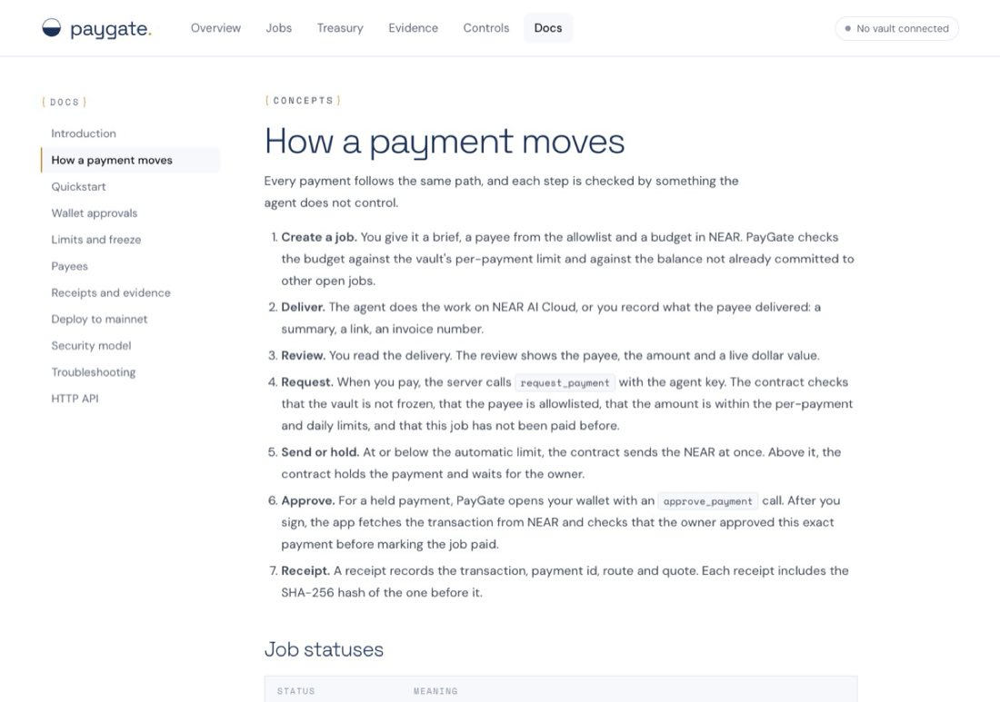
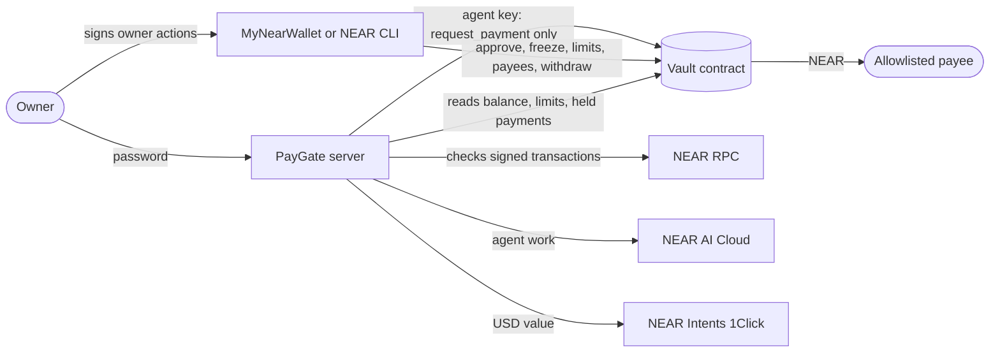
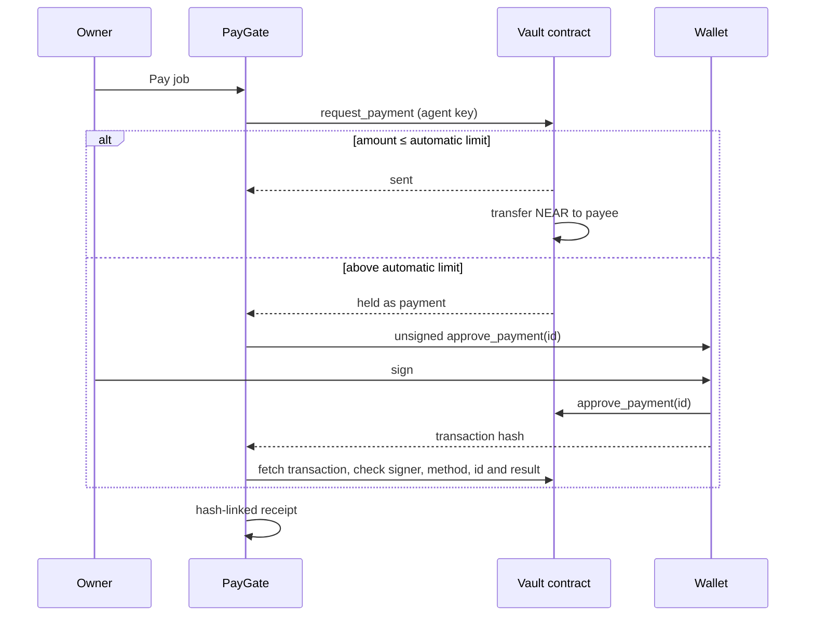

<div align="center">

# ◒ PayGate

**Agent payments with limits the agent cannot change.**

PayGate lets a company give an AI agent a budget without giving it control of the money. A NEAR smart contract holds the funds and enforces the owner's rules, so even a fully hijacked agent cannot overspend or pay an attacker.

[Quick start](#quick-start) · [Deploy to mainnet](#deploy-to-mainnet) · [Security model](#security-model) · [Contract reference](#contract-reference) · [HTTP API](#http-api)

   


</div>

---

## Contents

1. [The problem](#the-problem)
2. [How PayGate solves it](#how-paygate-solves-it)
3. [Features](#features)
4. [What is real](#what-is-real)
5. [Architecture](#architecture)
6. [Quick start](#quick-start)
7. [Using PayGate](#using-paygate)
8. [Deploy to mainnet](#deploy-to-mainnet)
9. [Host on Railway](#host-on-railway)
10. [Configuration](#configuration)
11. [Security model](#security-model)
12. [Contract reference](#contract-reference)
13. [HTTP API](#http-api)
14. [Testing and verification](#testing-and-verification)
15. [Project structure](#project-structure)
16. [Troubleshooting](#troubleshooting)
17. [Limitations](#limitations)
18. [Hackathon notes](#hackathon-notes)

---

## The problem

AI agents are starting to pay for things: research, APIs, contractors, other agents. An agent that can pay can also be tricked into paying the wrong person. A single line hidden in a document, an email or a job brief can tell it to send funds somewhere else.

The usual defences live in the wrong place. Rules in the agent's prompt can be argued away. Rules in the app's code are bypassed by anyone who controls the app or the agent's keys. Once the agent is compromised, so is the budget.

## How PayGate solves it

PayGate moves the rules to a place the agent cannot reach: a smart contract on NEAR.

- **The agent can only ask.** Its single key is a NEAR function-call key that can call one method, `request_payment`. The network rejects anything else, including transfers, new keys, other contracts and owner methods.
- **The contract decides.** It pays only allowlisted payees, within a per-payment limit and a daily limit, and pays each job only once.
- **You approve anything large.** Above the automatic limit, the contract holds the payment until the owner approves it from their own wallet. The PayGate server never holds the owner key.
- **Everything leaves evidence.** Every payment has a NEAR transaction and a hash-linked receipt.

A worst-case attack demo hijacks the agent and uses its real key to try 12 ways of stealing the funds. Every attempt is blocked by a named rule, and the attacker receives 0 NEAR. See [docs/attack-demo-log.txt](docs/attack-demo-log.txt).

## Features

| Area | What you get |
| --- | --- |
| **On-chain vault** | Rust contract with a payee allowlist, automatic, per-payment and daily limits, one payment per job, held payments, freeze and an owner withdrawal that works while frozen. |
| **Restricted agent** | One function-call key limited to `request_payment`, with a capped gas allowance. |
| **Wallet approvals** | Approvals, rejections, freezes, limit changes, payee changes and withdrawals are built by PayGate and signed in MyNearWallet. Any other wallet or NEAR CLI works by pasting the transaction hash. |
| **On-chain verification** | Before recording an approval, PayGate fetches the transaction and checks the signer, contract, method, payment id and result. |
| **Jobs workflow** | Create, deliver, review, pay or hold, approve or reject, cancel. Budgets are checked against limits and against funds already committed. |
| **NEAR AI Cloud** | The agent can do the work through NEAR AI Cloud, with chat id, request and response hashes and response signature saved with the receipt. |
| **Attestation check** | Fetches NEAR AI Cloud's TDX report with a fresh nonce and checks its format, nonce binding and configuration measurement. |
| **Dollar values** | A live NEAR Intents 1Click quote values each payment in USD at review time. Quotes are dry, so no swap is made. |
| **Evidence room** | Receipts with transaction links, SHA-256 hash chain verification and JSON export. |
| **Owner-only access** | A public deployment requires a password, uses secure session cookies and limits sign-in attempts. |
| **In-app docs** | Concepts, quickstart, approvals, limits, deployment, security, troubleshooting and the API, readable before sign-in. |

<table>
<tr>
<td width="50%"></td>
<td width="50%"></td>
</tr>
<tr>
<td align="center"><sub>Controls: freeze, limits and payees, each signed in your wallet</sub></td>
<td align="center"><sub>In-app documentation</sub></td>
</tr>
</table>

## What is real

| Part | Status |
| --- | --- |
| Vault contract, agent key restriction, limits, allowlist, freeze | **Real.** Enforced by NEAR on mainnet, testnet or a local node. |
| Payments | **Real NEAR**, sent to the payee's account. |
| Owner actions | **Signed in your wallet.** The server refuses to start if an owner key is configured for testnet or mainnet. |
| Balance, daily spend, limits, held payments | **Read live** from the contract. |
| Dollar values | **Live** NEAR Intents 1Click dry quotes. |
| NEAR AI Cloud inference | **Live** with `NEAR_AI_API_KEY`. Without it, you record deliveries yourself. |
| NEAR AI Cloud attestation | **Live.** Intel's signature on the quote is not verified; use the [NEAR AI Verification Center](https://docs.near.ai/cloud/verification/verification-center) for that. |
| Independent security audit | **Not done.** Start with small limits and a small balance. |

## Architecture



### Who holds what

| Part | Held by | Can do |
| --- | --- | --- |
| Vault contract | Nobody. Its own key is deleted during setup | Holds funds and enforces every rule |
| Agent key | PayGate server | Call `request_payment` on the vault, nothing else |
| Owner account | Your wallet | Approve, reject, freeze, change limits and payees, withdraw |
| Workspace | PayGate server, behind your password | Jobs, deliveries, labels and receipts |

### Payment flow



## Quick start

Requires **Node.js 22.22.2 or later**. The first local-node run downloads the NEAR sandbox binary.

```sh
git clone https://github.com/drained69/PayGate.git
cd PayGate
npm install
```

### Watch an attack fail

```sh
npm run demo:attack
```

This starts a local NEAR node, deploys the vault and plays an agent hijacked by a prompt injection, using its real key. The demo plays the worst case directly instead of relying on a model's behaviour. Each attack prints `BLOCKED` with the rule that stopped it:

| Attempt | Stopped by |
| --- | --- |
| Pay the attacker through the vault | Payee allowlist |
| Send above the per-payment limit | Per-payment limit |
| Replay a paid job | One payment per job |
| Transfer from the agent account | Function-call key |
| Add the attacker to the allowlist | Function-call key |
| Raise the limits | Function-call key |
| Withdraw from the vault | Function-call key |
| Give the agent a full-access key | Function-call key |
| Call a different contract | Function-call key |
| Pose as the agent from another account | Agent check |
| Forge the refund callback | Private callback |
| Pay while frozen | Freeze |

It also shows a held payment being rejected, a failed transfer being refunded, and a drain of small payments stopping at the daily limit.

### Run the app on a local node

```sh
npm run dev:chain
```

Open http://localhost:3000. A vault with one payee is deployed for you. A local node has no wallet, so a built-in local wallet signs owner actions; it is enabled only for a local node. Everything is deleted when you stop the command.

## Using PayGate

1. **Add payees.** In **Controls**, add the NEAR accounts the agent may pay and give them labels.
2. **Create a job.** In **Jobs**, set a title, a brief, a payee and a budget in NEAR. PayGate refuses budgets above the per-payment limit or above the funds not already committed to open jobs.
3. **Deliver.** Select **Run agent** to have the agent do the work on NEAR AI Cloud, or **Record delivery** to describe or link what the payee delivered.
4. **Review and pay.** The review shows the delivery, the payee, the amount and its live dollar value.
   - At or below the automatic limit, **Pay** sends the NEAR at once.
   - Above it, **Request payment** asks the vault, which holds the payment for you.
5. **Approve.** **Approve in wallet** opens MyNearWallet. After you sign, PayGate checks the transaction on-chain and records the payment. You can also reject it, or paste a hash signed elsewhere.
6. **Inspect.** **Evidence** lists every receipt with its transaction, verifies the hash chain, exports JSON and checks the NEAR AI enclave report.
7. **Respond to incidents.** In **Controls**, **Freeze in wallet** stops every new and held payment at once. **Treasury** lets you withdraw while frozen.

Job statuses: `Working` → `Review` → (`Awaiting approval`) → `Paid`, or `Cancelled` from Working or Review.

## Deploy to mainnet

The deploy runs on your own machine. The owner key is used for that run only and is never written to disk.

### Before you start

- A mainnet account to own the vault, such as `you.near`, with its key exported from your wallet.
- Enough NEAR for the vault funding plus about 0.4 NEAR. About **2.04 NEAR** of the vault funding stays locked to store the contract code.
- The payee accounts. Each must already exist on mainnet; the script checks.
- Your limits. Choose the automatic limit as the most you could lose in a day if the server were breached.

> **Tip:** To use a key you can revoke afterwards, add a new full-access key to your account just for the deployment, then delete it in your wallet when you are done.

### 1. Check the plan

Without the confirmation flag, the script checks everything and prints a summary. It sends nothing.

```sh
NEAR_NETWORK=mainnet \
NEAR_OWNER_ACCOUNT=you.near \
NEAR_OWNER_KEY=ed25519:... \
VAULT_FUND=3 LIMIT_AUTO=0.1 LIMIT_MAX=1 LIMIT_DAILY=2 \
PAYEES=contractor.near,research.near \
npm run vault:deploy
```

### 2. Deploy

Run the same command with ` -- --yes-mainnet` at the end. The script:

1. creates `paygate-vault.you.near` and deploys the contract;
2. initializes it with your account as owner and your limits;
3. creates `paygate-agent.you.near` with a single key that can only call `request_payment`;
4. adds your payees to the allowlist;
5. deletes the vault's own key, so its code can never be replaced.

It writes `data/chain.json`. That file contains the agent's restricted key: keep it private and never commit it (`data/` is git-ignored).

### 3. Run it

Locally, `npm start` reads `data/chain.json`. To host it, see [Host on Railway](#host-on-railway). Add funds at any time by sending NEAR to the vault account from any wallet.

Testnet works the same way with `NEAR_NETWORK=testnet`, and every amount defaults to a small test value.

## Host on Railway

The repository includes a `Dockerfile`. Setting `PUBLIC_URL` turns on hosted mode: the server listens on all interfaces, requires `PAYGATE_PASSWORD`, sends HSTS and uses secure cookies.

```sh
railway init --name paygate
railway add --service paygate
railway domain --service paygate
railway service link paygate
railway volume add --mount-path /data
railway variables --service paygate \
  --set PUBLIC_URL=https://your-domain.up.railway.app \
  --set DATA_DIR=/data \
  --set PAYGATE_PASSWORD='a long random password'
railway variables --service paygate --set "PAYGATE_CHAIN_JSON=$(cat data/chain.json)"
railway up --service paygate
```

Optionally set `NEAR_AI_API_KEY` so the agent can do the work. Then run the deployment check. It signs in and reads, and never pays or changes anything:

```sh
PAYGATE_PASSWORD='your password' npm run check:deployed -- https://your-domain.up.railway.app
```

It checks:

- health and security headers;
- that every API endpoint requires a session, that foreign origins are refused and that the session cookie is secure;
- the vault, receipts and enclave report;
- the mobile layout.

## Configuration

### Server

| Variable | Default | Purpose |
| --- | --- | --- |
| `PAYGATE_PASSWORD` | none | Owner password. Required when `PUBLIC_URL` is set; at least 12 characters |
| `PUBLIC_URL` | none | Public https address. Turns on hosted mode. `RAILWAY_PUBLIC_DOMAIN` also works |
| `DATA_DIR` | `./data` | Where the workspace is saved. Use a persistent volume when hosted |
| `PAYGATE_CHAIN_JSON` | none | Vault settings as JSON, instead of `DATA_DIR/chain.json` |
| `PAYGATE_CHAIN` | none | Path to a vault settings file |
| `NEAR_AI_API_KEY` | none | Lets the agent do the work on NEAR AI Cloud |
| `NEAR_AI_MODEL` | `qwen/qwen3.5-397b-a17b` | Model for inference and attestation |
| `PORT` | `3000` | Port |
| `HOST` | `127.0.0.1` locally, `0.0.0.0` hosted | Listen address |

`NEAR_OWNER_KEY` is accepted only with a local-node vault. With a testnet or mainnet vault, the server refuses to start if it is set.

### Vault deployment (`npm run vault:deploy`)

| Variable | Default | Purpose |
| --- | --- | --- |
| `NEAR_NETWORK` | required | `testnet` or `mainnet` |
| `NEAR_OWNER_ACCOUNT` | required | Account that will own the vault |
| `NEAR_OWNER_KEY` | required | Its key, for this run only |
| `VAULT_FUND` | `3` on testnet, required on mainnet | NEAR sent to the vault, including about 2.04 locked for code storage |
| `LIMIT_AUTO` | `0.1` on testnet, required on mainnet | Paid without approval |
| `LIMIT_MAX` | `0.5` on testnet, required on mainnet | Maximum per payment |
| `LIMIT_DAILY` | `1` on testnet, required on mainnet | Maximum per 24-hour window |
| `PAYEES` | none | Comma-separated allowlist |
| `AGENT_FUND` | `0.3` | NEAR for the agent account |
| `AGENT_ALLOWANCE` | `0.25` | Gas allowance on the agent key |
| `VAULT_NAME`, `AGENT_NAME` | `paygate-vault`, `paygate-agent` | Sub-account names |
| `NEAR_RPC_URL` | FastNEAR | RPC endpoint |

## Security model

| Rule | Enforced by | Stops |
| --- | --- | --- |
| Agent key can only call `request_payment` | NEAR access key | Direct transfers, new keys, other contracts, owner methods |
| Payee allowlist | Contract | Paying an attacker |
| Per-payment and daily limits | Contract | Large or repeated theft |
| Approval above the automatic limit | Contract and your wallet | Large payments nobody reviewed |
| Each job paid once | Contract | Replayed payments |
| Limit and allowlist changes apply to held payments | Contract | A held payment slipping through after rules tighten |
| Freeze, including held payments | Contract | Everything, until you resume |
| Withdraw works while frozen | Contract | Funds stuck during an incident |
| Owner methods require 1 yoctoNEAR | Contract | Calls from any function-call key |
| Vault has no keys | Deployment | Replacing the contract code |
| Owner key stays in your wallet | Deployment | A server breach taking the vault |
| Approvals checked on-chain | Server | Forged callbacks recording payments that never happened |
| Password, secure cookies, origin checks, rate limits | Server | Strangers using the app |

### Remaining risks

- **Server breach.** Someone who takes over the server, or steals the agent key, can spend up to the automatic limit per payment and the daily limit per day, only to allowlisted payees. They cannot approve held payments, change rules or withdraw.
- **Fixed daily windows.** The 24-hour windows are fixed, so spending at the end of one window and the start of the next can reach twice the daily limit in a short time.
- **Agent quotas.** A hijacked agent can use up its 50 daily requests or fill the queue of 20 held payments, which blocks payments until you reject them.
- **Gas allowance.** When the agent's gas allowance runs out, it stops until you add a new restricted key or call `set_agent`.
- **No independent audit.** The contract has 18 unit tests and an end-to-end attack demo, but has not been independently audited.

Full trust boundaries are in [REPRODUCIBILITY.md](REPRODUCIBILITY.md).

## Contract reference

Source: [contract/src/lib.rs](contract/src/lib.rs). Built WASM: `contract/res/paygate_vault.wasm`.

| Method | Caller | Description |
| --- | --- | --- |
| `new(owner, agent, limits)` | Vault itself, once | Initializes. Private, so it cannot be front-run |
| `fund()` | Anyone, payable | Adds NEAR |
| `request_payment(recipient, amount, job_id)` | Agent | Sends at once at or below `auto_limit`, otherwise holds. Returns `{id, status}` |
| `approve_payment(id)` | Owner, 1 yocto | Re-checks allowlist, limits and freeze, then pays |
| `reject_payment(id)` | Owner, 1 yocto | Drops a held payment and frees its job id |
| `set_frozen(frozen)` | Owner, 1 yocto | Freezes or resumes all payments |
| `set_limits(limits)` | Owner, 1 yocto | Requires `auto_limit ≤ max_payment ≤ daily_limit` |
| `set_recipient(recipient, allowed)` | Owner, 1 yocto | Adds or removes a payee |
| `set_agent(agent)` | Owner, 1 yocto | Replaces the agent account |
| `withdraw(amount)` | Owner, 1 yocto | Sends NEAR to the owner, even while frozen |
| `get_policy()` | View | Owner, agent, limits, frozen, spend in window, window end, spendable balance |
| `get_pending()` | View | Held payments |
| `get_recipients()` | View | Allowlist |

Events use the NEP-297 standard `paygate_vault`: `payment_sent`, `payment_pending`, `payment_rejected`, `payment_failed` and `freeze_changed`. A failed transfer is refunded to the vault by a private callback, which restores the daily spend and frees the job id.

Contract constants: 24-hour window, at most 20 held payments, at most 50 requests per window, job ids up to 64 characters.

## HTTP API

All endpoints need a session when a password is set. POST requests need the header `X-PayGate: 1` and, if sent, an allowed `Origin`.

| Endpoint | Purpose |
| --- | --- |
| `GET /healthz` | Health check, no session needed |
| `GET /api/session` | Whether you are signed in and whether a password is required |
| `POST /api/login` | `{password}`. Sets an HttpOnly session cookie for 12 hours |
| `POST /api/logout` | Ends the session |
| `GET /api/state` | Jobs, receipts and payee labels |
| `GET /api/vault` | Live balance, limits, daily spend, payees and held payments |
| `GET /api/integrations` | Connection status of each service |
| `GET /api/verify` | Recomputes the receipt hash chain |
| `GET /api/attestation` | Fetches and checks the NEAR AI Cloud report |
| `POST /api/action` | Job and owner actions, below |

| Action | Body | Result |
| --- | --- | --- |
| `create` | `{title, brief, payee, amount}` | New job |
| `deliver` | `{id, text}` | Owner-recorded delivery |
| `run` | `{id}` | Agent delivery from NEAR AI Cloud |
| `quote` | `{id}` | USD value from NEAR Intents |
| `pay` | `{id}` | Sent, or held for approval |
| `confirm` | `{id, txHash}` | Records a verified approval or rejection |
| `owner` | `{kind, …}` | Wallet link for `approve`, `reject`, `freeze`, `limits`, `payee` or `withdraw` |
| `cancel` | `{id}` | Cancels a job and releases its budget |
| `label` | `{account, label}` | Sets a payee label |

## Testing and verification

| Command | What it checks | Needs |
| --- | --- | --- |
| `npm test` | 19 tests: job and receipt rules, NEAR services, sign-in, sessions, origin checks, rate limits, startup refusals | Nothing, runs offline |
| `cd contract && cargo test` | 18 contract unit tests | Rust 1.97.1 |
| `npm run demo:attack` | 12 attacks against a real local node | NEAR sandbox, downloaded on first run |
| `npm run test:browser` | Docs, sign-in, setup guidance, receipts, enclave report, layout | Chromium |
| `npm run test:chain` | The full app on a local node through the wallet redirect (list below) | NEAR sandbox and Chromium |
| `npm run check:live` | Real 1Click quote and NEAR AI attestation | Internet, no key |
| `npm run check:deployed -- <url>` | Read-only check of a deployment | `PAYGATE_PASSWORD` |

`npm run test:chain` covers:

- automatic and approved payments, and rejections;
- freeze, limits, payees and withdrawal;
- forged approval hashes;
- interrupted and tampered payments;
- balances checked on-chain.

Install Chromium with `npx playwright install chromium`. On macOS you can use your installed Chrome instead by prefixing the command with `CHROME_PATH='/Applications/Google Chrome.app/Contents/MacOS/Google Chrome'`. Screenshots are saved to `test-results/`.

## Project structure

```
contract/            Vault contract in Rust, with the built WASM in contract/res/
chain.mjs            Vault deployment, agent requests, wallet links, on-chain checks
domain.mjs           Job, payment and receipt rules
near.mjs             NEAR AI Cloud, attestation checks, 1Click quotes
server.mjs           HTTP server, sign-in, persistence
public/              Web app: index.html, app.js, docs.js, style.css
scripts/             Vault deployment, local node, attack demo, browser and deployment checks
test/                Unit and server tests
docs/                Attack demo log, screenshots, demo post draft, original design proposal
Dockerfile           Production image
```

## Troubleshooting

| Message | Fix |
| --- | --- |
| `Set PAYGATE_PASSWORD to at least 12 characters` | Hosted servers need a password. Set it and redeploy. |
| `Cannot create /data` | Attach a volume and set `DATA_DIR` to its mount path. |
| `is not a PayGate workspace` | The data folder holds a workspace from an older version. Move it aside. |
| `Remove NEAR_OWNER_KEY` | The owner signs in their wallet on testnet and mainnet. Delete the variable. |
| `Budget exceeds the vault balance not already committed` | Cancel unneeded jobs or add NEAR to the vault. |
| `The vault is frozen` | Unfreeze in **Controls**. |
| `That transaction is not the expected owner action` | The hash is not your approval or rejection of this payment. Check the payment number. |
| `The transfer … failed and the funds returned to the vault` | The payee account does not exist on this network. Fix the payee and pay again. |
| `A pending payment for this job has different terms` | Something requested a payment for this job with other terms. Reject it in your wallet. |

## Limitations

- Payments are in NEAR. The dollar value is an estimate at review time.
- Wallet links use MyNearWallet. Other wallets work by pasting the transaction hash.
- One owner and one workspace per deployment.
- The workspace is a JSON file on disk, not encrypted. The NEAR transactions are the authoritative record.
- The contract has not been independently audited.

## Hackathon notes

Built for NEAR HACKATHON. Suggested tracks: **security** (on-chain spending limits, restricted keys, wallet approvals, freeze, attack demo) and **privacy** (NEAR AI Cloud inference and attestation checks). Libraries: `near-api-js` at runtime, `near-sdk` in the contract, `near-sandbox` and Playwright for tests. Development used AI coding tools.

## License

[MIT](LICENSE)
