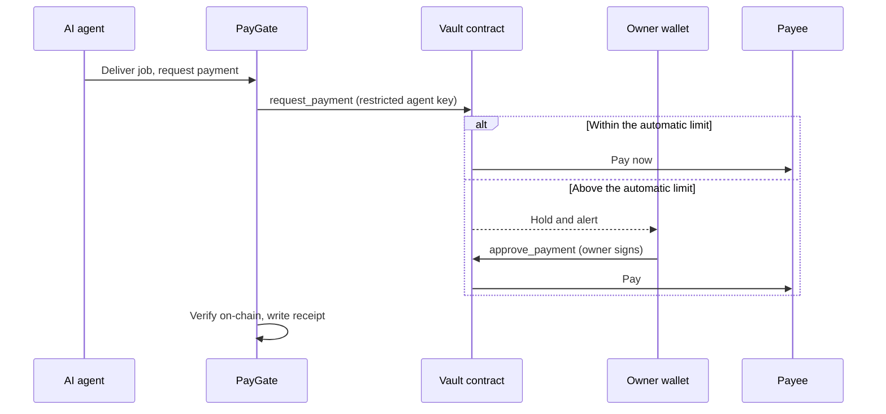
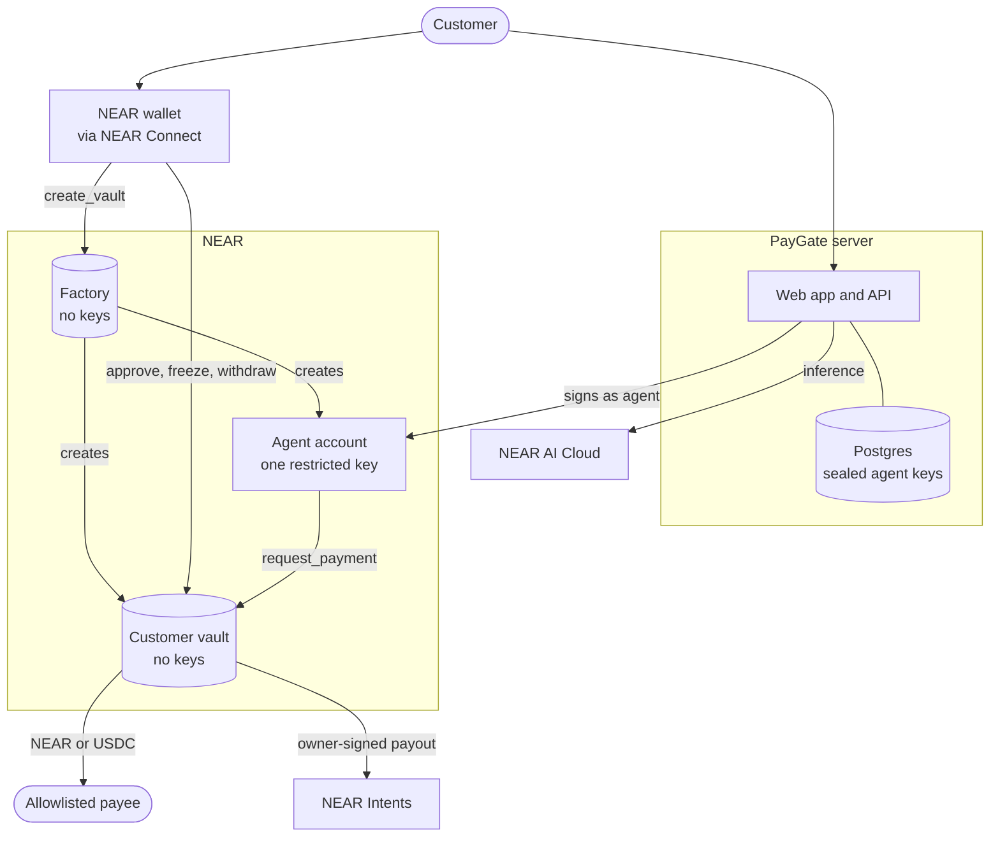
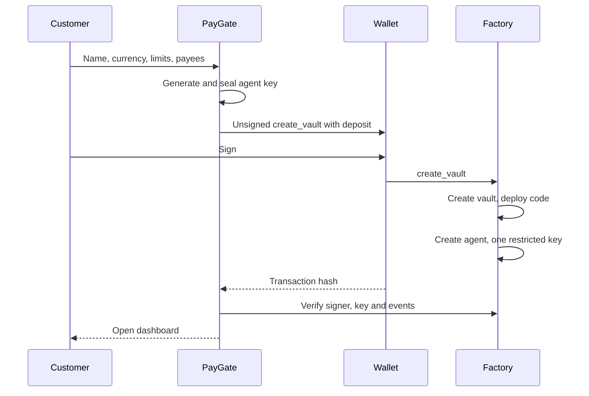

<div align="center">

<picture>
  <source media="(prefers-color-scheme: dark)" srcset="docs/images/logo-on-dark.svg">
  
</picture>

# PayGate

**Give your AI agent a budget it can't overspend.**

Non-custodial spending vaults for AI agents on NEAR. The spending rules live in a smart contract the customer owns, so a hijacked agent cannot break them.

[**Live app (testnet)**](https://trypaygate.xyz) · [Judge guide](JUDGES.md) · [Judge quickstart](#judge-quickstart) · [How it works](#how-it-works) · [NEAR technology](#near-technology-used) · [Architecture](#architecture) · [Quick start](#quick-start) · [Security](#security-model) · [Contracts](#contract-reference)

     


</div>

---

## Overview

- **Problem.** An AI agent that can pay can be tricked into paying the wrong person. A single injected line in a document or job brief is enough.
- **Solution.** A vault contract owned by the customer holds the money. The agent's only key can *ask* the vault to pay, and the vault decides by rules the agent cannot change: allowlisted payees, per-payment and daily limits, one payment per job, and owner approval for anything large.
- **Proof.** An attack demo hijacks the agent and uses its real key to try 12 ways of stealing the funds. All 12 are blocked on-chain, and the attacker receives 0 NEAR ([log](docs/attack-demo-log.txt)).
- **Built on NEAR.** Rust smart contracts, function-call access keys, NEP-413 sign-in, NEP-366 meta-transactions, NEP-141 and NEP-145 for USDC, NEP-297 events, NEAR Connect, NEAR AI Cloud and NEAR Intents 1Click. See [NEAR technology used](#near-technology-used).
- **Status.** Live on NEAR testnet at [trypaygate.xyz](https://trypaygate.xyz). Mainnet-ready but not launched: the launch steps are in [docs/MAINNET.md](docs/MAINNET.md). The contracts have had an in-house review but no independent audit yet.

## Contents

1. [Judge quickstart](#judge-quickstart)
2. [The problem](#the-problem)
3. [How it works](#how-it-works)
4. [NEAR technology used](#near-technology-used)
5. [Features](#features)
6. [Deployments](#deployments)
7. [Architecture](#architecture)
8. [Quick start](#quick-start)
9. [Using PayGate](#using-paygate)
10. [Agent API and MCP](#agent-api-and-mcp)
11. [Costs](#costs)
12. [Self-hosting](#self-hosting)
13. [Configuration](#configuration)
14. [Security model](#security-model)
15. [Contract reference](#contract-reference)
16. [HTTP API](#http-api)
17. [Testing](#testing)
18. [Project structure](#project-structure)
19. [Roadmap](#roadmap)
20. [Limitations](#limitations)
21. [Hackathon submission](#hackathon-submission)
22. [Troubleshooting](#troubleshooting)
23. [License](#license)

---

## Judge quickstart

Start with [JUDGES.md](JUDGES.md) for a claim-to-code map. Run `npm ci` and `npm run check:judge` to run the app tests and the on-chain attack demo with the committed contract WASM. The first sandbox run downloads the NEAR node binary. No NEAR AI key or real funds are required. Rust and Chromium are needed only for the respective extended checks below.

**A. Watch a hijacked agent fail to steal (about 2 minutes)**

1. Run `git clone https://github.com/drained69/PayGate.git && cd PayGate && npm ci`.
2. Run `npm run demo:attack`. You see 12 `BLOCKED` lines, each naming the rule that stopped it, and then `Result: the attacker received 0 NEAR`. Every step is a real transaction on a local NEAR node. A saved run is in [docs/attack-demo-log.txt](docs/attack-demo-log.txt).

**B. Use the whole product on a local NEAR node (about 5 minutes)**

1. Run `npm run dev:chain`. You see `PayGate on a local NEAR node → http://localhost:3000`, the factory account and the test accounts.
2. Open http://localhost:3000, select **Sign in with NEAR** and choose `alice.sandbox` in the local wallet. You see the vault setup form.
3. Enter a vault name, keep the suggested limits, enter `payee.sandbox` under **Payees** and select **Create vault in wallet**. You see "Your vault is live." and the dashboard.
4. In **Jobs**, create a job for `payee.sandbox` with a budget of 0.05 NEAR, select **Record delivery**, then **Review & pay** and **Pay 0.05 NEAR**. You see "Paid from the vault." In **Evidence**, the receipt says "Paid automatically" and links its transaction.
5. Create a second job with a budget of 0.3 NEAR, above the automatic limit of 0.1. Record a delivery, then select **Review & pay** and **Request payment**. The job shows "Awaiting approval". Select **Approve in wallet**, and the receipt says "Paid with owner approval".
6. In **Controls**, select **Freeze in wallet**. The vault contract now refuses every payment until you unfreeze.

**C. Run every automated check (about 10 minutes)**

| Run | You see |
| --- | --- |
| `npm test` | `fail 0` |
| `cd contract && cargo test` (Rust 1.97.1) | `41 passed` |
| `cd contract/factory && cargo test` | `12 passed` |
| `npx playwright install chromium`, then `npm run test:chain` | `Chain checks passed: …`. It covers the product end to end on a local node, including USDC vaults, a cross-chain payout through a stand-in 1Click, closing a vault, retiring the factory, and the Agent API over REST and MCP |
| `npm run check:live` (internet) | A real NEAR Intents 1Click quote and a real NEAR AI Cloud attestation check |

**D. Try the hosted app on testnet**

1. Open https://trypaygate.xyz. The page says "Live on NEAR testnet".
2. Select **Sign in with NEAR** and choose a NEAR Connect wallet that supports testnet, such as Meteor or HOT, with a testnet account. Free testnet NEAR is at https://near-faucet.io.
3. Create a vault with at least the minimum the form shows, then follow steps B4 to B6, using a second testnet account as the payee.

The hosted testnet factory is an earlier release that creates NEAR vaults. USDC vaults, closing and retiring are covered by C. Cross-chain payouts run only on mainnet, because NEAR Intents has no testnet.

## The problem

AI agents now pay for things: research, APIs, contractors and other agents. An agent that can pay can also be talked into paying an attacker. Prompt injection hides an instruction in content the agent reads, such as a web page, an email or a job brief.

The usual defences sit in the wrong place:

- **Rules in the prompt** can be argued away by the same injection.
- **Rules in the application** are bypassed by anyone who controls the application or steals the agent's key.
- **A custodial wallet** puts every customer's money in one operator's hands.

Once the agent is compromised, so is the budget.

## How it works

PayGate moves the rules to a place the agent cannot reach: a NEAR smart contract that the customer owns.

1. **Sign in with NEAR.** The customer's wallet signs a one-time message (NEP-413). PayGate checks the signature, and checks on-chain that the key is a full-access key of that account. There are no passwords.
2. **One transaction creates the vault.** The customer signs a single call to the PayGate factory. It creates a vault owned by the customer, with no keys of its own, and an agent account whose only key can call one method on that vault: `request_payment`.
3. **The agent asks; the contract decides.** The vault pays only allowlisted payees, within a per-payment and a daily limit, and pays each job once.
4. **The customer approves anything large.** Above the automatic limit, the vault holds the payment until the customer approves it in their own wallet. PayGate never holds an owner key.
5. **Everything leaves evidence.** Every payment has a NEAR transaction and a hash-linked receipt. Work done on NEAR AI Cloud keeps its signed response and attestation evidence.



## NEAR technology used

Every item below is used in the shipped code.

**Why these NEAR primitives matter:** A function-call access key lets the agent sign its own requests without giving it a general-purpose wallet. The owner controls the allowlist and limits in the vault contract, so a compromised server cannot quietly relax them. NEAR's named sub-accounts let one factory create a distinct vault and restricted agent account for each customer in a single wallet-approved setup flow. NEP-366 can move gas payment to a relayer without changing which key is authorized to request payment. These are separate controls: the access key limits *what the agent can call*, while the vault limits *who can be paid and how much*.

### Protocol and standards

| Technology | How PayGate uses it | Where |
| --- | --- | --- |
| **Rust smart contracts** ([near-sdk-rs](https://github.com/near/near-sdk-rs) 5.30) | The vault enforces every spending rule, and the factory creates vaults. Collections from `near_sdk::store`, plus promises and callbacks that restore balances when a transfer fails | [`contract/src/lib.rs`](contract/src/lib.rs), [`contract/factory/src/lib.rs`](contract/factory/src/lib.rs) |
| **Function-call access keys with allowance** | The agent's only key can call `request_payment` on one vault, with a limited gas allowance. It cannot transfer, add keys or call owner methods. This is the core of the security model | Factory `on_vault` |
| **Keyless accounts and sub-accounts** | The factory and every vault end with no access keys. Vaults are `name.factory` sub-accounts, so only the factory can create them | Factory, [`scripts/deploy-platform.mjs`](scripts/deploy-platform.mjs) |
| **Batched actions in one receipt** | Vault creation runs `CreateAccount`, `Transfer`, `DeployContract` and `FunctionCall(new)` together, so nobody can front-run initialization | Factory `create_vault` |
| **Storage staking** | Each vault pays for its own code and state from the customer's deposit. `close()` uses `DeleteAccount` to return all of it to the owner | Vault `close`, factory `vault_fund` |
| **One-yoctoNEAR guard** | Owner methods require 1 attached yoctoNEAR, which only a full-access key can send. A leaked function-call key cannot call them | Vault `assert_owner` |
| **NEP-413** (signed messages) | Wallet sign-in with a nonce bound to the site, verified against the account's on-chain full-access keys | [`src/chain.mjs`](src/chain.mjs) `verifySignIn` |
| **NEP-366** (meta-transactions) | Optional gas relayer. The agent signs a `DelegateAction` and an operator account pays the gas. NEAR still enforces the agent key's method restriction | [`src/chain.mjs`](src/chain.mjs) `relayed` |
| **NEP-141** (fungible tokens) | USDC vaults receive tokens through `ft_on_transfer` and pay with `ft_transfer`, counting only deposits from the vault's own token | Vault |
| **NEP-145** (storage management) | `storage_deposit` registers the vault, payees and payout addresses with USDC | Vault `pay_external`, server |
| **NEP-297** (events) | `payment_sent`, `payment_pending`, `payment_failed`, `vault_created` and others. The server reads them to confirm outcomes | Both contracts, [`src/chain.mjs`](src/chain.mjs) |
| **Circle native USDC on NEAR** | Dollar budgets: `17208628…133a1` on mainnet, Circle's testnet USDC on testnet | [`src/chain.mjs`](src/chain.mjs) `USDC` |

### NEAR products and tools

| Product | How PayGate uses it |
| --- | --- |
| **[NEAR Connect](https://www.npmjs.com/package/@hot-labs/near-connect)** (`@hot-labs/near-connect` 0.12) | The wallet selector: Meteor, HOT, Intear, Nightly, OKX, Ledger and more. Each wallet runs in a sandboxed iframe under a CSP with a nonce per response. It handles sign-in and every owner transaction |
| **[near-api-js](https://github.com/near/near-api-js)** 7 | The server builds wallet transactions, signs agent requests and meta-transactions, reads views and checks transaction outcomes on-chain |
| **[NEAR AI Cloud](https://docs.near.ai/cloud)** | Private inference with the customer's own API key. PayGate keeps the response signature with the receipt and checks NEAR AI's Intel TDX attestation report (quote format, nonce binding, gateway measurement) |
| **[NEAR Intents 1Click](https://docs.near-intents.org)** | Dry quotes value each payment in dollars without a swap. Live quotes pay USDC to Base, Arbitrum, Ethereum, Optimism, Polygon, Avalanche or Solana through an owner-signed payout to a one-time deposit address |
| **[near-sandbox](https://www.npmjs.com/package/near-sandbox)** (nearcore 2.14) | Runs a real local NEAR node for the end-to-end checks and the attack demo |
| **FastNEAR RPC**, with the NEAR public RPC as fallback | Comma-separated RPC endpoints fail over to each other |
| **NearBlocks** | Explorer links on every receipt and transaction |
| **Shade Agents** (design only) | A design for moving the agent key into a TEE-attested worker: [docs/shade-agent-design.md](docs/shade-agent-design.md) |

## Features

| Area | What customers get |
| --- | --- |
| **Wallet sign-in** | NEP-413 sign-in through NEAR Connect, checked against on-chain full-access keys. Single-use nonces, bound to the site |
| **One-click vault** | A keyless factory creates the vault and its restricted agent from one signed transaction, and refunds the deposit if a step fails |
| **On-chain rules** | Payee allowlist; automatic, per-payment and daily limits; one payment per job; held payments; freeze; withdrawal that works while frozen |
| **Wallet approvals** | Approve, reject, freeze, change limits or payees, withdraw and close, each signed in the customer's wallet and confirmed on-chain. NEAR CLI and other wallets work by pasting the transaction hash |
| **Jobs workflow** | Create, deliver, review, pay or hold, approve or reject, cancel. Budgets are checked against the limits and against funds already committed |
| **USDC budgets** | Vaults can hold and pay Circle's native USDC, with limits in dollars. Deposits and payee registration take one click |
| **Cross-chain payouts** | USDC vaults pay addresses on seven other chains through NEAR Intents. The owner signs every payout within the vault's limits, and failed swaps refund to the owner. Mainnet only |
| **Agent API and MCP** | Scoped API keys let the customer's own agents read the vault, create and deliver jobs and request payment over REST or MCP. Agents can never approve, freeze, change rules or withdraw |
| **Bring your own AI** | The customer's NEAR AI Cloud key, stored encrypted, lets the agent do the work. The signed response is kept with the receipt |
| **Alerts** | Signed webhooks (Slack, Discord or any https endpoint) and Telegram for held payments, payments and deliveries |
| **Gas relayer** | Optional NEP-366 relayer: agents never run out of gas, and customer deposits are 0.28 NEAR smaller |
| **Evidence** | Receipts with transaction links, SHA-256 hash-chain verification, JSON export and an attestation check |
| **Close and recover** | Owners can close an idle vault and get all of its NEAR back, including its storage |
| **Privacy** | Customers can delete their stored data. Agent private keys are generated on the server; saved agent and NEAR AI keys are never returned to the browser |

<table>
<tr>
<td width="50%"></td>
<td width="50%"></td>
</tr>
<tr>
<td align="center"><sub>Customer dashboard</sub></td>
<td align="center"><sub>Controls, each change signed in the wallet</sub></td>
</tr>
</table>

## Deployments

| Network | URL | Status |
| --- | --- | --- |
| Testnet | [trypaygate.xyz](https://trypaygate.xyz) | Live, with factory `paygate.drained99.testnet`. Online through at least 2026-11-25 |
| Testnet (second instance) | [paygate-production-d611.up.railway.app](https://paygate-production-d611.up.railway.app) | Same factory, separate data |
| Mainnet | — | Not launched. The contracts and server are mainnet-ready; see [docs/MAINNET.md](docs/MAINNET.md) |

| Component | What is real |
| --- | --- |
| Vault and factory contracts, agent key restriction, limits, allowlist, freeze | **Enforced by NEAR** |
| Payments | **Real NEAR or USDC**, sent to the payee's account |
| Sign-in and owner actions | **Signed in the customer's wallet.** PayGate never holds owner keys |
| Balance, daily spend, limits, held payments | **Read live** from the customer's vault |
| Dollar values | **Live** NEAR Intents 1Click dry quotes |
| Cross-chain payouts | **Built and tested locally** against a stand-in 1Click. They need mainnet, because NEAR Intents has no testnet |
| NEAR AI Cloud inference and attestation | **Live** with the customer's own key. Intel's signature on the quote is not verified here; use the [NEAR AI Verification Center](https://docs.near.ai/cloud/verification/verification-center) |
| Independent security audit | **Not yet.** Customers are advised to start with small limits |

## Architecture



### Who holds what

| Component | Held by | Can do |
| --- | --- | --- |
| Factory | Nobody: its key is deleted at setup | Create vaults and agents. It keeps no customer funds |
| Customer vault | Nobody: it is created without keys | Hold funds and enforce every rule |
| Agent key | PayGate, encrypted with AES-256-GCM | Call `request_payment` on one vault |
| Owner account | The customer's wallet | Approve, reject, freeze, change limits and payees, withdraw, close |
| Workspace | PayGate, in Postgres | Jobs, deliveries, labels and receipts |

### Creating a vault



The factory deploys its stored vault code into `name.factory`, initializes it with the customer as owner, and creates `name-agent.factory` with a single function-call key. If any step fails, the deposit is refunded.

### Sources of truth and recovery

| State | Source of truth | What happens if the PayGate server is unavailable |
| --- | --- | --- |
| Vault balance, limits, payees, freeze state and held payments | Customer's NEAR vault contract | The funds and rules remain on-chain. The owner can use a compatible NEAR wallet or CLI to call the contract. |
| Owner authority | Customer's own NEAR account and full-access key | PayGate cannot impersonate the owner or approve a held payment. The owner must retain access to their wallet. |
| Agent authority | Restricted function-call key on its agent account | A lost or exhausted agent key can be replaced by an owner-signed `set_agent`; the server's saved copy cannot change owner controls. |
| Jobs, labels, deliveries and receipt chain | PayGate workspace store: Postgres when configured, otherwise local files | They need a database or file backup. On-chain payments remain visible, but off-chain job descriptions and receipt history may be lost without one. |
| NEAR AI key and saved agent key | Encrypted in the workspace under `PAYGATE_SECRET` | Back up the secret separately from the database. Losing it makes saved keys unreadable; it does not transfer ownership of the vault. |

Receipts are hash-linked to detect edits against a retained prior hash. They are **not digital signatures or a substitute for NEAR transaction receipts**. The server checks the on-chain transaction before recording a payment as complete; see [REPRODUCIBILITY.md](REPRODUCIBILITY.md) for exact verification boundaries.

## Quick start

Requires **Node.js 22.22.2 or later**. The first run downloads the NEAR sandbox binary.

```sh
git clone https://github.com/drained69/PayGate.git
cd PayGate
npm install
npm run dev:chain
```

This runs the whole platform on a local NEAR node, with test customers, a local USDC and a built-in local wallet. Open <http://localhost:3000>, select **Sign in with NEAR** and choose a test account. The local wallet works only on a local node; the server refuses test accounts on testnet and mainnet.

The command starts the local node, deploys the test factory and token, creates test accounts, and starts the server. It prints the factory and test account IDs. Keep that terminal open while using the app. Sandbox accounts and tokens are only for local development; they are separate from hosted testnet and mainnet accounts. To use the hosted app, bring a wallet and testnet NEAR as described in [Judge quickstart D](#judge-quickstart).

Then watch an attack fail:

```sh
npm run demo:attack
```

| Attempt with the hijacked agent's real key | Stopped by |
| --- | --- |
| Pay the attacker through the vault | Payee allowlist |
| Send above the per-payment limit | Per-payment limit |
| Replay a paid job | One payment per job |
| Transfer from the agent account | Function-call key |
| Add the attacker to the allowlist | Function-call key |
| Raise the limits | Function-call key |
| Withdraw from the vault | Function-call key |
| Give the agent a full-access key | Function-call key |
| Call a different contract | Function-call key |
| Pose as the agent from another account | Agent check |
| Forge the refund callback | Private callback |
| Pay while frozen | Freeze |

## Using PayGate

**NEAR AI Cloud is optional.** Vault creation, manually recorded deliveries, REST and MCP jobs, payments, approvals, and payment verification work without a NEAR AI API key. To enable **Run agent**, save your own key in **Settings → NEAR AI Cloud key**. PayGate stores it encrypted for your account.

**Require owner approval for every payment.** Set the automatic limit to `0` when creating the vault, or update it in **Controls → Spending limits** and sign in your wallet. The vault holds every positive payment request under this policy. Your per-payment and daily ceilings still apply, including when you approve a request.

1. **Sign in** with **Sign in with NEAR** and approve the message in your wallet.
2. **Create your vault.** Choose a name, NEAR or USDC, payees, limits and funding, then sign one transaction. See [Costs](#costs) for the minimum.
3. **Optionally add your NEAR AI key** in **Settings** so the agent can do the work, and connect **alerts**.
4. **Create a job** with a brief, a payee and a budget.
5. **Deliver.** Select **Run agent**, or **Record delivery** to describe what the payee delivered.
6. **Review and pay.** Up to the automatic limit, **Pay** sends at once. Above it, the vault holds the payment until you select **Approve in wallet**.
7. **Inspect** receipts and transactions in **Evidence**. **Freeze**, **Withdraw** or **Close** at any time from **Controls** and **Treasury**.

Job statuses: `Working` → `Review` → `Awaiting approval` (only above the automatic limit) → `Paid`. A job can be `Cancelled` from `Working` or `Review`.

If the wallet closes after signing, paste its transaction hash into **Review approval** to recover the result. PayGate matches the vault's payment event to the job, payee and amount, then checks the transfer receipts. Recording the same hash again returns the existing result. If the vault reports that an approved transfer failed and it restored its payment accounting, the job returns to **Review**. Fix the destination, such as registering the payee for USDC in **Controls**, before requesting payment again.

If an automatic payment reached NEAR but the job still shows **Review**, open **Review & pay → Record an existing payment**. Paste the payment transaction hash from the vault's history. PayGate checks the original agent request and its transfer receipts before restoring the paid receipt. This action only reads the chain and records the result in PayGate.

In **Evidence**, select **Verify payment** on a receipt to recheck the finalized NEAR transaction against its vault, job, recipient and amount. For a cross-chain payment, this verifies the NEAR deposit. **Check delivery** looks up the separate destination result from NEAR Intents. **Verify receipt chain** checks the stored receipt hashes and links.

## Agent API and MCP

Your own AI agent can use PayGate directly. Create a key in **Settings → API keys for your agents**, choose whether it may request payments, and copy it once. PayGate stores only its hash.

**MCP** (streamable HTTP at `/mcp`), for example in Claude Code:

```sh
claude mcp add --transport http paygate https://trypaygate.xyz/mcp --header "Authorization: Bearer $PAYGATE_KEY"
```

Tools: `get_vault`, `list_payees`, `list_jobs`, `get_job`, `create_job`, `deliver_job`, `request_payment` (only for keys allowed to pay) and `cancel_job`.

**REST** under `/api/v1`, with the same key as a Bearer token:

```sh
curl https://trypaygate.xyz/api/v1/jobs \
  -H "Authorization: Bearer $PAYGATE_KEY" -H "Content-Type: application/json" \
  -d '{"title":"Competitor pricing","brief":"Summarize three pricing pages","payee":"contractor.testnet","amount":0.05}'

curl -X POST https://trypaygate.xyz/api/v1/jobs/PG-1a2b3c4d/deliver \
  -H "Authorization: Bearer $PAYGATE_KEY" -H "Content-Type: application/json" \
  -d '{"text":"Report link"}'

curl -X POST https://trypaygate.xyz/api/v1/jobs/PG-1a2b3c4d/pay \
  -H "Authorization: Bearer $PAYGATE_KEY"
```

A payment at or below the automatic limit returns the job as `Paid`, with its transaction. A larger one returns `Awaiting approval` until the owner approves it in their wallet. Agents cannot approve, freeze, change limits or payees, or withdraw, and the vault refuses any payee outside the allowlist on-chain.

If an agent loses the API response, repeat the payment request with the same job ID. A job already marked `Paid` returns its original receipt, and a job in `Awaiting approval` returns its existing request. If the request is still running, REST returns HTTP `409` and MCP reports an in-progress error. Use `get_job` or `GET /api/v1/jobs/{id}` to check what happened.

## Costs

PayGate charges no fees. Customers fund their own accounts; operators pay only for deploying the platform and, optionally, relayer gas.

| Customer cost | Without relayer | With relayer |
| --- | --- | --- |
| Vault code and state, locked in the vault and returned by `close()` | about 1.99 NEAR | about 1.99 NEAR |
| Agent account | 0.3 NEAR | 0.02 NEAR |
| **Minimum deposit** | **about 2.30 NEAR** | **about 2.02 NEAR** |
| USDC payee registration | 0.00125 NEAR once per payee | Same |
| Cross-chain payout | NEAR Intents swap fee, plus 0.00125 NEAR to register the deposit address | Same |

| Operator cost (one-time) | Amount |
| --- | --- |
| Factory code storage (locked) | about 1.5 NEAR |
| Vault code stored in the factory (locked) | about 1.9 NEAR |
| Refund buffer kept in the factory | about 2.5 NEAR |
| **`FACTORY_FUND`** | **6 NEAR. Nothing is burned, and `retire()` returns all of it** |

The operator who deployed the factory can call `retire()` to delete it and recover all 6 NEAR. Existing vaults are separate accounts and keep working; only new vault creation stops.

The factory stores the vault code once and deploys a copy into each vault. Publishing the code as a global contract instead would burn ten times the storage cost: about 24 NEAR for this contract.

## Self-hosting

### 1. Deploy the platform

Run once from your own machine with an operator account. The script asks for the operator key with input hidden, uses it for that run only, and never saves it.

```sh
NEAR_NETWORK=mainnet NEAR_OPERATOR_ACCOUNT=you.near FACTORY_FUND=6 npm run platform:deploy
```

Without `-- --yes-mainnet`, the script checks everything, prints a cost summary and sends nothing. With it, the script:

1. Creates `paygate.you.near` with a temporary key. Your account becomes its operator, the only account that can later `retire()` it.
2. Deploys the factory and stores the vault code in it, in one transaction.
3. Deletes the factory's key, so nobody can change it.
4. Checks on-chain that the factory has no keys, and reports the expected vault code hash.

The factory account name must be 25 characters or fewer; set `FACTORY_NAME` for a shorter one.

### 2. Host the server

The repository includes a [Dockerfile](Dockerfile) that runs on any container host. On Railway:

```sh
railway add --database postgres
railway variables --service paygate \
  --set NEAR_NETWORK=mainnet \
  --set PAYGATE_FACTORY=paygate.you.near \
  --set 'DATABASE_URL=${{Postgres.DATABASE_URL}}' \
  --set PUBLIC_URL=https://your-domain \
  --set PAYGATE_SECRET="$(openssl rand -hex 32)"
railway up --service paygate
npm run check:deployed -- https://your-domain
```

> [!IMPORTANT]
> `PAYGATE_SECRET` encrypts every customer's agent key and NEAR AI key. **Back it up.** Without it, stored agent keys cannot be decrypted, and customers would need to name a new agent with `set_agent`.

`PUBLIC_URL` must be the exact address customers use. The server rejects requests for any other host, and wallet sign-in is bound to it. The deployed check browses the site as a visitor and signs nothing. `GET /healthz` answers without a customer session; `GET /api/config` shows the selected network, factory, minimum deposit and feature availability. Inspect both after deployment, then sign in with a wallet on that same network before opening vault creation to users.

The server selects Postgres only when `DATABASE_URL` is set. Without it, it writes JSON files under `DATA_DIR`. A hosted deployment needs durable storage either way. Postgres is the intended multi-instance store because account updates use row locks; a mounted volume with file storage is suitable only when one server process owns those files. Back up both the database and `PAYGATE_SECRET`, and test restoration before relying on the hosted service.

### 3. Before opening to the public

Follow [docs/MAINNET.md](docs/MAINNET.md). It covers the pre-mainnet review, the testnet rehearsal, backups, a dedicated RPC provider, the legal review of `public/legal.js` and an independent audit.

## Configuration

Use [`.env.example`](.env.example) as a list of variables. **The server does not load `.env` automatically.** Set variables in the shell, your process manager or Railway. If you copy the example into a local `.env`, export it into the shell before `npm run dev` or `npm start` (for example, `set -a; . ./.env; set +a` in a trusted local shell). Do not commit the filled file. `npm run dev:chain` supplies its own local sandbox configuration.

| Variable | Default | Purpose |
| --- | --- | --- |
| `NEAR_NETWORK` | `testnet` | `mainnet`, `testnet` or `sandbox` |
| `PAYGATE_FACTORY` | none | Factory account from `platform:deploy`. Without it, vault creation is closed |
| `DATABASE_URL` | none | Postgres. Without it, data is stored in files in `DATA_DIR` |
| `PAYGATE_SECRET` | generated locally | Encrypts customer keys. Required when hosted; at least 32 characters |
| `PUBLIC_URL` | none | Public https address. Turns on hosted mode. `RAILWAY_PUBLIC_DOMAIN` also works |
| `NEAR_RPC_URL` | FastNEAR, with NEAR's public RPC as fallback | Comma-separated RPC endpoints that fail over. Use a dedicated provider for a public mainnet service |
| `NEAR_AI_MODEL` | `qwen/qwen3.5-397b-a17b` | Model for inference and attestation |
| `PAYGATE_USDC` | Circle USDC on mainnet and testnet | USDC token account. Required on a local node |
| `PAYGATE_CROSSCHAIN` | `on` on mainnet, `off` elsewhere | Cross-chain USDC payouts through NEAR Intents 1Click |
| `ONECLICK_JWT` | none | Optional 1Click API key; without one, 1Click adds a small fee |
| `PAYGATE_RELAYER_ACCOUNT`, `PAYGATE_RELAYER_KEY` | none | Optional gas relayer: an account holding only gas money. Recommended, because it lowers customer deposits |
| `TELEGRAM_BOT_TOKEN` | none | Optional bot from @BotFather; turns on Telegram alerts |
| `DATA_DIR` | `./data` | Local data folder |
| `PORT`, `HOST` | `3000`; `127.0.0.1` locally, `0.0.0.0` hosted | Listen address |

Platform deployment only: `NEAR_OPERATOR_ACCOUNT`, `NEAR_OPERATOR_KEY` (prompted if unset), `FACTORY_NAME` (default `paygate`) and `FACTORY_FUND` (default `6`).

### Deployment modes

| Mode | Start command | Chain and wallet | Persistence | Purpose |
| --- | --- | --- | --- | --- |
| Local sandbox | `npm run dev:chain` | Local NEAR node and stand-in wallet | Temporary local data | Reproduce the product and run the attack demo without external funds |
| Local server against testnet | `NEAR_NETWORK=testnet npm run dev` with a deployed testnet factory configured | Real testnet wallet | Files by default, or Postgres | Develop against the public test network |
| Hosted testnet | `npm start` or the Dockerfile with server variables | Real testnet wallet through NEAR Connect | Durable Postgres recommended | Public rehearsal with test tokens |
| Mainnet | Dockerfile after [mainnet checklist](docs/MAINNET.md) | Real mainnet wallet | Durable Postgres and a backed-up secret | Future production launch; not currently deployed |

`PUBLIC_URL` or Railway's `RAILWAY_PUBLIC_DOMAIN` enables hosted mode. Hosted mode binds the server on `0.0.0.0`, requires `PAYGATE_SECRET`, and marks its session cookie Secure. Locally, the default bind address is `127.0.0.1`. Keep `NEAR_NETWORK`, factory account, RPC, and wallet network aligned; a testnet vault is not a mainnet vault.

## Security model

| Rule | Enforced by | Prevents |
| --- | --- | --- |
| Agent key can only call `request_payment` on its vault | NEAR access key | Direct transfers, new keys, other contracts, owner methods |
| Payee allowlist | Vault | Paying an attacker |
| Per-payment and daily limits | Vault | Large or repeated theft |
| Approval above the automatic limit | Vault and wallet | Large payments nobody reviewed |
| Each job paid once | Vault | Replayed payments |
| Limit and allowlist changes apply to held payments | Vault | A held payment slipping through after the rules tighten |
| Freeze, including held payments; withdraw while frozen | Vault | Ongoing theft; stuck funds |
| Owner methods require 1 yoctoNEAR | Vault | Calls from any function-call key |
| Failed transfers restore the ledger, daily spend and job id | Vault callbacks | Funds or limits lost to a failed transfer |
| Vault initialized only by itself or its creator | Vault | Someone else initializing a new vault |
| Vault and factory have no keys; vault code fixed in the factory | Deployment | Code swaps and upgrades |
| Only the operator can retire the factory, never while a creation is open | Factory | Stranded deposits; interfering with customer vaults |
| Factory refunds on failure | Factory | Lost deposits on taken names |
| Sign-in checked against on-chain full-access keys, single-use nonce | Server | Signing in as someone else; replay |
| Approvals and vault creation checked on-chain | Server | Forged wallet callbacks |
| Agent and AI keys sealed with AES-256-GCM, never sent to the browser | Server | A database leak exposing usable keys |
| Webhooks only to public https addresses, checked on the IP actually used | Server | Server-side request forgery, DNS rebinding |
| HttpOnly sessions, origin checks, rate limits, CSP with nonces, HSTS | Server | Cross-site requests, brute force, framing, injected scripts |

### Remaining risks

- **Server breach.** Someone with the server and `PAYGATE_SECRET` can use agent keys within each customer's automatic and daily limits, and only to that customer's payees. They cannot approve held payments, change rules or withdraw. [A Shade Agent design](docs/shade-agent-design.md) would remove this risk.
- **Daily windows.** A window starts with the first request after the previous one ends, so two windows can fall back to back.
- **Agent quotas.** A hijacked agent can use its 50 daily requests, or fill the queue of 20 held payments until the customer rejects them.
- **Gas allowance.** Without a relayer, an agent's 0.295 NEAR allowance lasts about 35 payment requests. The customer then names a new agent with `set_agent`.
- **Cross-chain payouts.** The owner's wallet shows the NEAR Intents deposit address, not the final address, so the owner relies on PayGate's quote.
- **No independent audit yet.** The in-house review is in [docs/MAINNET.md](docs/MAINNET.md), and trust boundaries are in [REPRODUCIBILITY.md](REPRODUCIBILITY.md).

To report a vulnerability, please open a private [security advisory](https://github.com/drained69/PayGate/security/advisories/new) rather than a public issue.

## Contract reference

### Vault

Source: [`contract/src/lib.rs`](contract/src/lib.rs). Built: `contract/res/paygate_vault.wasm` (194 KB).

| Method | Caller | Description |
| --- | --- | --- |
| `new(owner, agent, limits, recipients?, token?)` | The vault or its creator | Initializes, optionally with first payees and a NEP-141 token such as USDC |
| `request_payment(recipient, amount, job_id)` | Agent | Pays at once at or below `auto_limit`, otherwise holds. Returns `{id, status}` |
| `approve_payment(id)` / `reject_payment(id)` | Owner, 1 yocto | Releases or drops a held payment |
| `set_frozen`, `set_limits`, `set_recipient`, `set_agent` | Owner, 1 yocto | Configuration |
| `withdraw(amount)` | Owner, 1 yocto | Sends NEAR, or the vault's token, to the owner, even while frozen |
| `withdraw_near(amount)` | Owner, 1 yocto | Token vaults: returns NEAR not needed for storage |
| `pay_external(recipient, amount, job_id)` | Owner, 1 yocto | Token vaults: registers `recipient` with the token and pays it within the limits. Used for NEAR Intents deposit addresses |
| `close()` | Owner, 1 yocto | Deletes the vault and sends all of its NEAR, including storage, to the owner. See below |
| `ft_on_transfer(sender_id, amount, msg)` | The vault's token | Credits deposits made with `ft_transfer_call`; returns other tokens |
| `fund()` | Anyone, payable | Adds NEAR |
| `get_policy()`, `get_pending()`, `get_recipients()` | View | State |

`close()` starts only when nothing is held, nothing is in flight and no tokens are left. It stops payments and deposits, then clears payees and paid-job records in batches of 100, because NEAR refuses to delete accounts with more than 10 KB of state. Finally it deletes the account. If gas runs out first, calling it again resumes.

Events (`paygate_vault`): `payment_sent`, `payment_pending`, `payment_rejected`, `payment_failed`, `freeze_changed`, `vault_closed`. `get_policy()` also reports `near_balance` and `closing`. Constants: 24-hour window, 20 held payments, 50 requests per window, job ids up to 64 characters.

### Factory

Source: [`contract/factory/src/lib.rs`](contract/factory/src/lib.rs). Built: `contract/res/paygate_factory.wasm` (154 KB).

| Method | Caller | Description |
| --- | --- | --- |
| `new(vault_code)` | The factory itself, once | Stores the vault code (borsh bytes). `get_config().vault_code` is its SHA-256 |
| `create_vault(name, agent_key, limits, recipients, token?, agent_fund?)` | Anyone, with at least `vault_fund` plus the agent funding | Creates `name.factory` owned by the caller, and `name-agent.factory` with one restricted key. `agent_fund` is 0.02 to 1 NEAR, default 0.3; the key's allowance is that amount minus 0.005 |
| `retire()` | Operator (the factory's parent account), 1 yocto | Deletes the factory and returns all of its NEAR to the operator. Refused while a vault creation is in progress. Existing vaults are unaffected |
| `get_config()` | View | Code hash, operator, `vault_fund`, default and minimum agent funding, `min_deposit`, token and external-payout support |

Names are 2 to 32 lowercase letters, digits or single dashes, and cannot end in `-agent`. Events (`paygate_factory`): `vault_created`, `vault_failed`, `agent_failed`, `factory_retired`.

Rebuild both contracts with `contract/build.sh` (Rust 1.97.1 and binaryen 133). Each vault's on-chain code hash equals the factory's `vault_code`.

## HTTP API

POST requests need the header `X-PayGate: 1`. Account endpoints need a session.

| Endpoint | Purpose |
| --- | --- |
| `GET /healthz` | Health check |
| `GET /api/config` | Network, factory, minimum deposit, USDC and cross-chain availability |
| `GET /api/session` | Signed-in account, if any |
| `POST /api/auth/challenge`, `POST /api/auth/verify` | NEP-413 sign-in; sets a 7-day HttpOnly session |
| `POST /api/logout` | Ends the session |
| `GET /api/state` | Account, vault and workspace; never any key |
| `GET /api/vault` | Live balance, limits, daily spend, payees, held payments |
| `GET /api/integrations`, `/api/verify`, `/api/attestation` | Services, receipt chain check, enclave report |
| `GET /api/v1/vault`, `/payees`, `/jobs`, `/jobs/{id}` | Agent API reads (Bearer API key) |
| `POST /api/v1/jobs`, `/jobs/{id}/deliver`, `/jobs/{id}/pay`, `/jobs/{id}/cancel` | Agent API actions |
| `POST /mcp` | MCP server: `initialize`, `tools/list`, `tools/call` |
| `POST /api/action` | Customer actions, selected by the `action` field (below) |

| Group | `action` values |
| --- | --- |
| Jobs | `create`, `deliver`, `run`, `quote`, `pay`, `confirm`, `cancel`, `label` |
| Vault | `vault-create`, `vault-confirm`, `vault-cancel`, `vault-closed` |
| Owner transactions (`owner` with `kind`) | `approve`, `reject`, `freeze`, `limits`, `payee`, `withdraw`, `withdraw-near`, `deposit`, `register`, `close` |
| Cross-chain | `external-payee`, `bridge-status` |
| Settings | `ai-key`, `api-key-create`, `api-key-revoke`, `alerts-webhook`, `alerts-telegram`, `alerts-test`, `delete-account` |

## Testing

The checks have different trust levels. Unit tests and the local chain demonstrate behavior against controlled fixtures. `check:live` verifies selected public integrations, while `check:deployed` is a read-only smoke check of a hosted site. Neither proves that a mainnet payment was made. The on-chain contract state and transaction receipts remain the final evidence for a payment.

| Command | What it checks | Requires |
| --- | --- | --- |
| `npm test` | Job rules, receipt integrity, workspace caps, cross-chain payees, NEAR services, encryption, NEP-413, server security, rate limits, startup refusals, alerts, file store | Local HTTP ports |
| `npm run check:judge` | App tests and on-chain attack demo without rewriting the saved log | NEAR sandbox |
| `cd contract && cargo test` | 41 vault tests: limits, allowlist, approvals, freeze, failed-transfer recovery, USDC, external payouts, spare NEAR, closing in batches | Rust 1.97.1 |
| `cd contract/factory && cargo test` | 12 factory tests: names, deposits, agent funding, code hash, retiring | Rust 1.97.1 |
| `npm run demo:attack` | 12 attacks against a real local node | NEAR sandbox |
| `npm run test:chain` | The full product on a local node (below) | NEAR sandbox, Chromium |
| `npm run test:browser` | Public pages, docs, legal pages, wallet picker, CSP nonces, mobile layout | Chromium |
| `npm run test:postgres` | Schema, row-locked concurrent updates, rollback, sessions, deletion | Docker or `DATABASE_URL` |
| `npm run check:live` | A real 1Click quote and NEAR AI attestation | Internet |
| `npm run check:deployed -- <url>` | Read-only check of a deployment | Chromium |

`npm run test:chain` drives the real UI through a stand-in wallet on a local node. It covers:

- Sign-in, vault creation through the factory, and each vault's code hash matching the factory's.
- Automatic and approved payments, rejections, freeze, limits, payees, withdrawal and closing a vault.
- Retiring the factory: only the operator can, its NEAR returns, and existing vaults keep working.
- Forged approvals and injected results.
- Signed webhook and Telegram alerts.
- Every agent payment relayed (NEP-366), with the agent's allowance untouched.
- A USDC vault: registration, deposit, payment, withdrawal and spare-NEAR withdrawal.
- A cross-chain payout to a Base address, only after the owner signs.
- Agent API keys over REST and MCP.
- Isolation between customers, taken names with full refunds, and forged and replayed sign-ins.
- Data deletion and the mobile layout.

Install Chromium with `npx playwright install chromium`. On macOS you can use an installed Chrome instead by prefixing commands with `CHROME_PATH='/Applications/Google Chrome.app/Contents/MacOS/Google Chrome'`.

### Verify the core claims yourself

| Claim | Reproduce it | What to look for |
| --- | --- | --- |
| A stolen agent key cannot pay an unapproved account or change owner controls | `npm run demo:attack` | Twelve attempted actions report `BLOCKED`; the attacker receives 0 NEAR on the local node. Inspect the corresponding contract checks instead of relying on the summary line alone. |
| The owner can create a vault without giving PayGate an owner key | Follow [Judge quickstart B](#judge-quickstart) | The wallet signs `create_vault`; the resulting vault and agent are separate accounts and the agent has a method-limited key. |
| Small payments and large payments take different paths | Create jobs on both sides of the automatic limit | One produces an on-chain payment after the agent request; the other remains held until a separate owner-signed approval. |
| A failed transfer does not consume a job or daily budget | Run the vault contract tests | Failure callbacks restore the pending ledger and spent counters; the test checks state after the callback. |
| A receipt corresponds to a real transaction | Open **Evidence** for a paid local or testnet job | Follow the transaction link and compare sender, receiver, amount and success status. The hash-linked receipt alone is not proof. |
| The deployed page is reachable | `npm run check:deployed -- https://trypaygate.xyz` | The public pages and configuration load. This check makes no wallet signature and sends no funds. |

Local chain tests use a stand-in 1Click for cross-chain payouts. The live check obtains a dry 1Click quote, which values an amount but does not settle it. The hosted testnet factory is an earlier NEAR-only release; use the local chain for USDC vault creation and closing until the new factory is deployed to a public network.

## Project structure

```text
.
├── src/                    Node.js server
│   ├── server.mjs          HTTP server: sign-in, sessions, customer actions, Agent API, MCP
│   ├── chain.mjs           NEAR: wallet transactions, on-chain checks, NEP-413, NEP-366 relaying
│   ├── near.mjs            NEAR AI Cloud inference and attestation, NEAR Intents 1Click
│   ├── domain.mjs          Job, payment and receipt rules
│   ├── store.mjs           Postgres or file storage with row-locked updates
│   ├── secrets.mjs         AES-256-GCM sealing of customer keys
│   └── alerts.mjs          Signed webhooks and Telegram
├── public/                 Web app, in-app docs, legal pages, wallet callback, NEAR Connect
├── contract/
│   ├── src/                Vault contract (Rust)
│   ├── factory/            Factory contract (Rust)
│   ├── test-token/         Local USDC for the sandbox
│   ├── res/                Built WASM, deployed as committed
│   └── build.sh            Contract build
├── scripts/                Platform deploy, local node, attack demo, end-to-end checks
├── test/                   Unit and server tests (node --test)
├── docs/                   Mainnet launch guide, Shade Agent design, attack log, screenshots
│   └── archive/            Original design proposal, kept for reference
├── video/                  Source for the narrated product demo (Remotion)
├── Dockerfile
└── REPRODUCIBILITY.md      Trust boundaries and how to verify each claim
```

### Where to change a feature

| Task | Primary files | Verification |
| --- | --- | --- |
| Change a payment limit, approval rule, payee rule or freeze behavior | `contract/src/lib.rs`, then `src/chain.mjs` if the contract interface changes | `cd contract && cargo test`, `npm run test:chain` |
| Change vault creation, initial funding or agent key permissions | `contract/factory/src/lib.rs`, `scripts/deploy-platform.mjs`, `src/chain.mjs` | Factory tests, `npm run demo:attack`, `npm run test:chain` |
| Change job states, receipts or payment validation | `src/domain.mjs`, `src/server.mjs` | `npm test`, `npm run test:chain` |
| Change the customer interface | `public/index.html`, `public/app.js`, `public/style.css` | `npm run test:browser`, `npm run test:chain` |
| Change sign-in or owner transaction confirmation | `src/server.mjs`, `src/chain.mjs`, `public/callback.js` | `npm test`, `npm run test:chain` |
| Change NEAR AI, attestation or Intents integrations | `src/near.mjs` | `npm test`, `npm run check:live` |
| Change storage or key handling | `src/store.mjs`, `src/secrets.mjs` | `npm test`, `npm run test:postgres` |
| Change container deployment | `Dockerfile`, `.dockerignore`, `src/server.mjs` | Build the image, then `npm run check:deployed -- <url>` after deploying |

The Dockerfile installs production dependencies and copies the server, static `public/` assets and built contract WASM files. `npm start` runs `src/server.mjs`; there is no separate frontend build step. The server serves the browser files directly, so changes to `public/` are visible after redeployment.

## Roadmap

- **Mainnet launch.** Deploy the factory, then open vault creation ([docs/MAINNET.md](docs/MAINNET.md)).
- **Independent audit** of both contracts.
- **TEE-held agent keys.** The [Shade Agent design](docs/shade-agent-design.md), so a server breach cannot use agent keys.
- **Rolling daily window** instead of fixed windows.
- **More tokens.** Any NEP-141 token the operator enables.

## Limitations

- One vault per customer account, holding either NEAR or USDC.
- Dollar values are estimates at review time.
- Cross-chain payouts need mainnet, because NEAR Intents has no testnet.
- About 0.02 NEAR stays in the agent account after a vault is closed.
- The contracts have not been independently audited.

## Hackathon submission

Built for **NEAR HACKATHON** (development window 2026-11-01 to 2026-11-14).

| Item | Detail |
| --- | --- |
| Development window | The repository's first commit is dated 2026-11-01. Every commit is inside the window, so there is no pre-hackathon baseline |
| Prior work | None. PayGate is a new project, not an existing product on NEAR or another chain |
| Submitted tracks | **AI Security & Defense** (`security`): restricted agent keys, on-chain limits and owner approvals. **Agent Economy** (`agents`): job delivery and payment requests over REST and MCP. **Autonomous Business** (`business`): owners set spending rules and agents operate within them. |
| Network | Testnet. Cross-chain payouts need mainnet, because NEAR Intents has no testnet; they are verified locally with a stand-in 1Click, and `npm run check:live` makes a real dry quote |
| Hosted demo | [trypaygate.xyz](https://trypaygate.xyz) |
| Submitted demo post | [PayGate demo on X](https://x.com/drained99/status/2120683021720306089) |
| How to verify | [Judge guide](JUDGES.md) and [quickstart](#judge-quickstart) |
| Libraries and tools | Server: `near-api-js`, `pg`. Browser: `@hot-labs/near-connect` (bundled). Contracts: `near-sdk`, with `near-contract-standards` only in the local test token. Tests: `near-sandbox`, Playwright. Demo video: Remotion. No template or boilerplate was used |
| AI disclosure | The team used Claude Code and Codex to write, review and test code and documentation. The demo video's narration was generated with Higgsfield |
| License | [MIT](LICENSE). The repository stays public through judging |

## Troubleshooting

| Symptom | First check |
| --- | --- |
| `npm run dev:chain` does not start | Confirm Node.js is at least 22.22.2 and the sandbox binary can download on first run. The command prints the local factory and accounts when ready. |
| Port 3000 is in use | Stop the existing server or set another `PORT` before starting the local app. |
| A hosted server exits with a secret error | Set a durable `PAYGATE_SECRET` of at least 32 characters. Store a backup; changing it after customers have saved keys makes those keys unreadable. |
| A hosted deployment reports an invalid host | Set `PUBLIC_URL` to the exact public origin or use Railway's `RAILWAY_PUBLIC_DOMAIN`. Do not include a path. |
| Wallet sign-in fails | Confirm the wallet is on the same NEAR network as the app, approve the signed message, and retry with a fresh challenge. Sign-in checks the key against the account on-chain. |
| Vault creation is unavailable | Check `GET /api/config` for the factory and `ready` state. A missing `PAYGATE_FACTORY` disables creation; the hosted testnet factory supports NEAR vaults only. |
| A vault cannot pay | Check the live vault balance, payee allowlist, freeze state, per-payment and daily limits, and whether the job has already been paid. A held payment needs owner approval. |
| Postgres is unavailable | Check `DATABASE_URL` and the database service. Without a configured URL, the server uses local files under `DATA_DIR`; changing stores does not migrate existing customer data automatically. |
| Cross-chain payout is not shown | It is a mainnet-only integration by default and requires a compatible USDC vault and the factory's external-payout support. Testnet has no NEAR Intents settlement environment. |
| An attestation check fails | Check that NEAR AI Cloud is reachable and that the returned quote matches the fresh nonce and expected measurement. PayGate's check does not verify Intel's quote signature. |

For a reproducible bug report, include the network, the command or UI step, the exact error, and a transaction hash when one exists. Never include a wallet seed phrase, owner key, agent key, `PAYGATE_SECRET`, or NEAR AI API key. Security issues belong in a private [GitHub advisory](https://github.com/drained69/PayGate/security/advisories/new).

## License

Released under the [MIT License](LICENSE).
