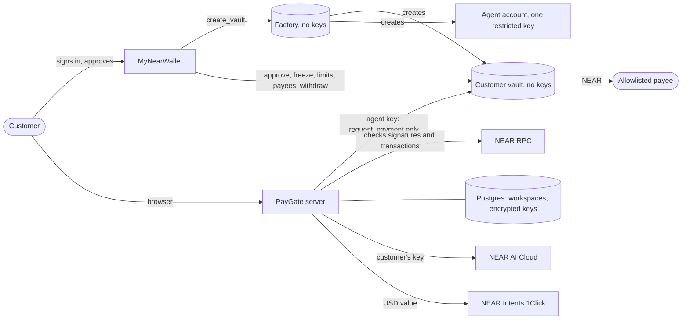
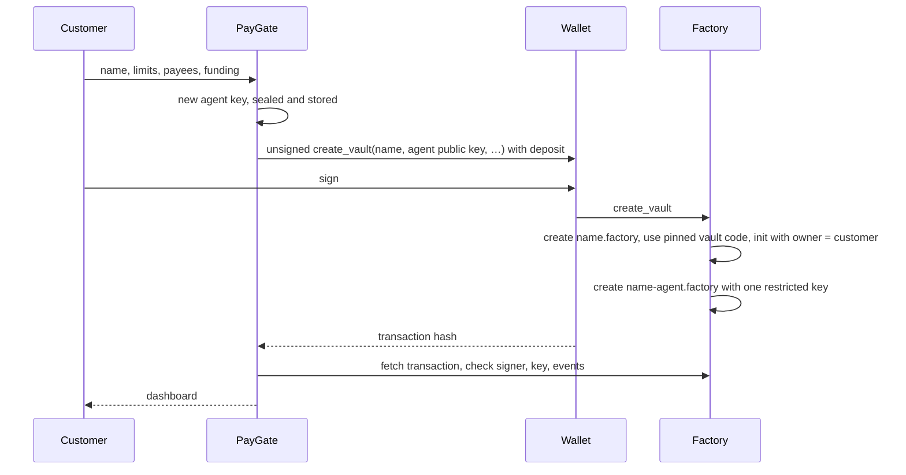

<div align="center">

# ◒ PayGate

**Give your AI agent a budget it can't overspend.**

PayGate is a public, non-custodial service on NEAR. Anyone can sign in with their wallet and create a spending vault for their AI agent. The vault is a smart contract the customer owns: it pays only their payees, within their limits, and holds anything large until they approve it in their own wallet.

[How it works](#how-it-works) · [Use PayGate](#using-paygate) · [Run your own](#run-your-own-paygate) · [Security model](#security-model) · [Contracts](#contract-reference) · [HTTP API](#http-api)

   


</div>

---

## Contents

1. [The problem](#the-problem)
2. [How it works](#how-it-works)
3. [Features](#features)
4. [What is real](#what-is-real)
5. [Architecture](#architecture)
6. [Using PayGate](#using-paygate)
7. [Try it locally](#try-it-locally)
8. [Run your own PayGate](#run-your-own-paygate)
9. [Configuration](#configuration)
10. [Security model](#security-model)
11. [Contract reference](#contract-reference)
12. [HTTP API](#http-api)
13. [Testing and verification](#testing-and-verification)
14. [Project structure](#project-structure)
15. [Troubleshooting](#troubleshooting)
16. [Limitations](#limitations)
17. [Hackathon notes](#hackathon-notes)

---

## The problem

AI agents are starting to pay for things: research, APIs, contractors, other agents. An agent that can pay can also be tricked into paying the wrong person. A single line hidden in a document, an email or a job brief can tell it to send funds elsewhere.

The usual defences live in the wrong place. Rules in the agent's prompt can be argued away. Rules in an app's code are bypassed by anyone who controls the app or the agent's keys. Once the agent is compromised, so is the budget.

## How it works

PayGate moves the rules to a place the agent cannot reach: a smart contract on NEAR that the customer owns.

- **Sign in with NEAR.** The customer's wallet signs a one-time message (NEP-413). PayGate checks the signature and that the key belongs to the account on-chain. There are no passwords.
- **One transaction creates the vault.** The customer signs a single call to the PayGate factory. It creates a vault owned by the customer, with no keys of its own, and an agent account whose only key can call one method, `request_payment`.
- **The contract decides.** The vault pays only allowlisted payees, within a per-payment limit and a daily limit, and pays each job only once.
- **The customer approves anything large.** Above the automatic limit, the vault holds the payment until the customer approves it in their wallet. PayGate never holds the owner key.
- **Everything leaves evidence.** Every payment has a NEAR transaction and a hash-linked receipt.

A worst-case attack demo hijacks the agent and uses its real key to try 12 ways of stealing the funds. Every attempt is blocked by a named rule, and the attacker receives 0 NEAR. See [docs/attack-demo-log.txt](docs/attack-demo-log.txt).

## Features

| Area | What customers get |
| --- | --- |
| **Wallet sign-in** | NEP-413 signed-message sign-in through MyNearWallet, verified against the account's full-access keys on-chain. Single-use nonces, bound to the site. |
| **One-click vault** | A keyless factory creates the customer's vault and restricted agent from one signed transaction, and refunds them if a step fails. Minimum deposit 0.4 NEAR. |
| **Pinned code** | Every vault runs the same global contract, pinned by code hash, so nobody can upgrade customer vaults later. |
| **On-chain rules** | Payee allowlist, automatic, per-payment and daily limits, one payment per job, held payments, freeze, and withdrawal that works while frozen. |
| **Wallet approvals** | Approve, reject, freeze, change limits, add or remove payees, withdraw, each signed in a wallet pop-up and checked on-chain. Other wallets and NEAR CLI work by pasting the transaction hash. |
| **Jobs workflow** | Create, deliver, review, pay or hold, approve or reject, cancel. Budgets are checked against limits and against funds already committed. |
| **Bring your own AI** | Customers add their own NEAR AI Cloud key, stored encrypted, to let the agent do the work. Chat id, request and response hashes and the response signature are kept with the receipt. |
| **Dollar values** | A live NEAR Intents 1Click quote values each payment at review time. Quotes are dry, so no swap is made. |
| **Evidence** | Receipts with transaction links, SHA-256 hash-chain verification, JSON export and a NEAR AI Cloud attestation check. |
| **Privacy controls** | Customers can delete their data at any time. Keys never reach the browser. |
| **Public site** | Homepage, pricing, FAQ, documentation, terms and privacy notice. |

<table>
<tr>
<td width="50%"></td>
<td width="50%"></td>
</tr>
<tr>
<td align="center"><sub>Customer dashboard</sub></td>
<td align="center"><sub>Controls, each change signed in the wallet</sub></td>
</tr>
</table>

## What is real

| Part | Status |
| --- | --- |
| Vault and factory contracts, agent key restriction, limits, allowlist, freeze | **Real.** Enforced by NEAR. |
| Payments | **Real NEAR**, sent to the payee's account. |
| Sign-in and owner actions | **Signed in the customer's wallet.** PayGate never holds owner keys. |
| Balance, daily spend, limits, held payments | **Read live** from the customer's vault. |
| Dollar values | **Live** NEAR Intents 1Click dry quotes. |
| NEAR AI Cloud inference | **Live** with the customer's own key. Without it, customers record deliveries. |
| NEAR AI Cloud attestation | **Live.** Intel's signature on the quote is not verified; use the [NEAR AI Verification Center](https://docs.near.ai/cloud/verification/verification-center) for that. |
| Independent security audit | **Not done.** Customers are told to start with small limits. |

## Architecture



### Who holds what

| Part | Held by | Can do |
| --- | --- | --- |
| Factory | Nobody, its key is deleted at setup | Create vaults and agents; keeps no customer funds |
| Customer vault | Nobody, it is created without keys | Hold funds and enforce every rule |
| Agent key | PayGate, encrypted with AES-256-GCM | Call `request_payment` on one vault |
| Owner account | The customer's wallet | Approve, reject, freeze, change limits and payees, withdraw |
| Workspace | PayGate, in Postgres | Jobs, deliveries, labels and receipts |

### Creating a vault



## Using PayGate

1. **Sign in** with **Sign in with NEAR** and approve the message in your wallet.
2. **Create your vault.** Choose a name, add payees, set limits and funding (at least 0.4 NEAR, of which 0.3 funds the agent account and its gas), then sign one transaction.
3. **Optionally add your NEAR AI key** in **Settings** so the agent can do the work.
4. **Create a job** with a brief, a payee and a budget in NEAR.
5. **Deliver.** **Run agent**, or **Record delivery** to describe what the payee delivered.
6. **Review and pay.** Up to the automatic limit, **Pay** sends at once. Above it, **Request payment** asks the vault, which holds it; **Approve in wallet** releases it.
7. **Inspect** receipts and transactions in **Evidence**; **Freeze** or **Withdraw** at any time from **Controls** and **Treasury**.

Job statuses: `Working` → `Review` → (`Awaiting approval`) → `Paid`, or `Cancelled` from Working or Review.

## Try it locally

Requires **Node.js 22.22.2 or later**. The first local-node run downloads the NEAR sandbox binary.

```sh
git clone https://github.com/drained69/PayGate.git
cd PayGate
npm install
```

Run the whole platform on a local NEAR node, with two test customers and a built-in local wallet:

```sh
npm run dev:chain
```

Open http://localhost:3000, select **Sign in with NEAR** and choose a test account. The local wallet works only on a local node; the server refuses test accounts on testnet or mainnet.

Watch an attack fail:

```sh
npm run demo:attack
```

| Attempt | Stopped by |
| --- | --- |
| Pay the attacker through the vault | Payee allowlist |
| Send above the per-payment limit | Per-payment limit |
| Replay a paid job | One payment per job |
| Transfer from the agent account | Function-call key |
| Add the attacker to the allowlist | Function-call key |
| Raise the limits | Function-call key |
| Withdraw from the vault | Function-call key |
| Give the agent a full-access key | Function-call key |
| Call a different contract | Function-call key |
| Pose as the agent from another account | Agent check |
| Forge the refund callback | Private callback |
| Pay while frozen | Freeze |

## Run your own PayGate

### 1. Deploy the platform

Run once, from your own machine, with an operator account. The operator key is used for that run only and is never saved.

| Cost | Amount |
| --- | --- |
| Publishing the vault code as a global contract (burned) | about 20.7 NEAR |
| Storing the factory code (locked) | about 1.8 NEAR |
| Buffer left in the factory for refunds | about 2.5 NEAR |
| **Recommended `FACTORY_FUND`** | **25 NEAR** |

Without the confirmation flag, the script checks everything and prints a summary. It sends nothing.

```sh
NEAR_NETWORK=mainnet NEAR_OPERATOR_ACCOUNT=you.near NEAR_OPERATOR_KEY=ed25519:... npm run platform:deploy
```

Run the same command with ` -- --yes-mainnet` at the end to deploy. The script:

1. creates `paygate.you.near` with a temporary key;
2. publishes the vault code as a global contract pinned by its hash;
3. deploys and initializes the factory with that hash;
4. deletes the factory's key, so nobody can change it.

The factory account name must be 25 characters or fewer. Set `FACTORY_NAME` for a shorter one.

### 2. Host it on Railway

```sh
railway add --database postgres
railway variables --service paygate \
  --set NEAR_NETWORK=mainnet \
  --set PAYGATE_FACTORY=paygate.you.near \
  --set 'DATABASE_URL=${{Postgres.DATABASE_URL}}' \
  --set PUBLIC_URL=https://your-domain.up.railway.app \
  --set PAYGATE_SECRET="$(openssl rand -hex 32)"
railway up --service paygate
```

`PAYGATE_SECRET` encrypts every customer's agent key and NEAR AI key. **Back it up.** Without it, stored agent keys cannot be decrypted, and customers would need a new agent through `set_agent`.

Then run the read-only check. It browses the site as a visitor and signs nothing:

```sh
npm run check:deployed -- https://your-domain.up.railway.app
```

### 3. Before you open to the public

- Have the Terms of use and Privacy notice in `public/legal.js` reviewed by a lawyer for your jurisdiction.
- Get the contracts independently audited.
- Turn on Postgres backups and keep `PAYGATE_SECRET` in a password manager.

## Configuration

| Variable | Default | Purpose |
| --- | --- | --- |
| `NEAR_NETWORK` | `testnet` | `mainnet`, `testnet` or `sandbox` |
| `PAYGATE_FACTORY` | none | Factory account from `platform:deploy`. Without it, vault creation is closed |
| `DATABASE_URL` | none | Postgres. Without it, data is stored in files in `DATA_DIR` |
| `PAYGATE_SECRET` | generated locally | Encrypts customer keys. Required when hosted; at least 32 characters |
| `PUBLIC_URL` | none | Public https address. Turns on hosted mode. `RAILWAY_PUBLIC_DOMAIN` also works |
| `NEAR_RPC_URL` | FastNEAR | RPC endpoint. Required for `sandbox` |
| `NEAR_AI_MODEL` | `qwen/qwen3.5-397b-a17b` | Model for inference and attestation |
| `DATA_DIR` | `./data` | Local data folder |
| `PORT`, `HOST` | `3000`; `127.0.0.1` locally, `0.0.0.0` hosted | Listen address |

Platform deployment only: `NEAR_OPERATOR_ACCOUNT`, `NEAR_OPERATOR_KEY`, `FACTORY_NAME` (default `paygate`), `FACTORY_FUND` (default `25`).

## Security model

| Rule | Enforced by | Stops |
| --- | --- | --- |
| Agent key can only call `request_payment` | NEAR access key | Direct transfers, new keys, other contracts, owner methods |
| Payee allowlist | Vault | Paying an attacker |
| Per-payment and daily limits | Vault | Large or repeated theft |
| Approval above the automatic limit | Vault and wallet | Large payments nobody reviewed |
| Each job paid once | Vault | Replayed payments |
| Limit and allowlist changes apply to held payments | Vault | A held payment slipping through after rules tighten |
| Freeze, including held payments; withdraw while frozen | Vault | Ongoing theft; stuck funds |
| Owner methods require 1 yoctoNEAR | Vault | Calls from any function-call key |
| Vault initialized only by itself or its creator | Vault | Someone else initializing a new vault |
| Vault and factory have no keys; code pinned by hash | Deployment | Code swaps and upgrades |
| Factory refunds on failure | Factory | Lost deposits on taken names |
| Sign-in checked against on-chain full-access keys, single-use nonce | Server | Signing in as someone else; replay |
| Approvals and vault creation checked on-chain | Server | Forged wallet callbacks |
| Agent and AI keys sealed with AES-256-GCM, never sent to the browser | Server | A database leak exposing usable keys |
| HttpOnly secure sessions, origin checks, rate limits, CSP, HSTS | Server | Cross-site requests, brute force, framing |

### Remaining risks

- **Server breach.** Someone with the server and `PAYGATE_SECRET` can use agent keys to spend up to each customer's automatic limit per payment and daily limit, only to that customer's payees. They cannot approve held payments, change rules or withdraw.
- **Fixed daily windows.** Spending at the end of one window and the start of the next can reach twice the daily limit in a short time.
- **Agent quotas.** A hijacked agent can use its 50 daily requests or fill the queue of 20 held payments until the customer rejects them.
- **Gas allowance.** The agent's 0.25 NEAR allowance eventually runs out; the customer can name a new agent with `set_agent`.
- **No independent audit yet.**

Full trust boundaries are in [REPRODUCIBILITY.md](REPRODUCIBILITY.md).

## Contract reference

### Vault

Source: [contract/src/lib.rs](contract/src/lib.rs). Built: `contract/res/paygate_vault.wasm`.

| Method | Caller | Description |
| --- | --- | --- |
| `new(owner, agent, limits, recipients?)` | The vault or its creator | Initializes, optionally with first payees |
| `fund()` | Anyone, payable | Adds NEAR |
| `request_payment(recipient, amount, job_id)` | Agent | Sends at once at or below `auto_limit`, otherwise holds. Returns `{id, status}` |
| `approve_payment(id)` / `reject_payment(id)` | Owner, 1 yocto | Releases or drops a held payment |
| `set_frozen`, `set_limits`, `set_recipient`, `set_agent` | Owner, 1 yocto | Configuration |
| `withdraw(amount)` | Owner, 1 yocto | Sends NEAR to the owner, even while frozen |
| `get_policy()`, `get_pending()`, `get_recipients()` | View | State |

Events (`paygate_vault`): `payment_sent`, `payment_pending`, `payment_rejected`, `payment_failed`, `freeze_changed`. Constants: 24-hour window, 20 held payments, 50 requests per window, job ids up to 64 characters.

### Factory

Source: [contract/factory/src/lib.rs](contract/factory/src/lib.rs). Built: `contract/res/paygate_factory.wasm`.

| Method | Caller | Description |
| --- | --- | --- |
| `new(vault_code)` | The factory itself, once | Pins the vault code hash |
| `create_vault(name, agent_key, limits, recipients)` | Anyone, at least 0.4 NEAR | Creates `name.factory` owned by the caller and `name-agent.factory` with one restricted key |
| `get_config()` | View | Code hash, agent funding, minimum deposit |

Names are 2–32 lowercase letters, digits or single dashes and cannot end in `-agent`. Events (`paygate_factory`): `vault_created`, `vault_failed`, `agent_failed`.

## HTTP API

POST requests need the header `X-PayGate: 1`. Account endpoints need a session.

| Endpoint | Purpose |
| --- | --- |
| `GET /healthz` | Health check |
| `GET /api/config` | Network, factory, wallet |
| `GET /api/session` | Signed-in account, if any |
| `POST /api/auth/challenge` | One-time NEP-413 message |
| `POST /api/auth/verify` | `{accountId, publicKey, signature, nonce}`; sets a 7-day HttpOnly session |
| `POST /api/logout` | Ends the session |
| `GET /api/state` | Account, vault and workspace; never any key |
| `GET /api/vault` | Live balance, limits, daily spend, payees, held payments |
| `GET /api/integrations`, `/api/verify`, `/api/attestation` | Services, receipt chain, enclave report |
| `POST /api/action` | `vault-create`, `vault-confirm`, `create`, `deliver`, `run`, `quote`, `pay`, `confirm`, `owner`, `cancel`, `label`, `ai-key`, `delete-account` |

## Testing and verification

| Command | What it checks | Needs |
| --- | --- | --- |
| `npm test` | 20 tests: job rules, NEAR services, encryption, NEP-413, server security, rate limits, startup refusals, file store | Nothing |
| `cd contract && cargo test` | 21 vault tests | Rust 1.97.1 |
| `cd contract/factory && cargo test` | 5 factory tests | Rust 1.97.1 |
| `npm run test:postgres` | Schema, row-locked concurrent updates, rollback, sessions, nonces, deletion, server start | Docker or `DATABASE_URL` |
| `npm run demo:attack` | 12 attacks against a real local node | NEAR sandbox |
| `npm run test:browser` | Homepage, docs, legal pages, sign-in hand-off to the wallet, layout | Chromium |
| `npm run test:chain` | The full public product on a local node (list below) | NEAR sandbox, Chromium |
| `npm run check:live` | Real 1Click quote and NEAR AI attestation | Internet |
| `npm run check:deployed -- <url>` | Read-only check of a deployment | Chromium |

`npm run test:chain` drives the real UI through the wallet pop-up and covers:

- sign-in, and vault creation through the factory, confirming on-chain that the vault has no keys and the agent has one restricted key;
- automatic and approved payments, rejections, freeze, limits, payees and withdrawal;
- forged approvals and injected results;
- isolation between two customers, taken vault names, and forged and replayed sign-ins;
- data deletion and the mobile layout.

Install Chromium with `npx playwright install chromium`, or on macOS use your installed Chrome by prefixing commands with `CHROME_PATH='/Applications/Google Chrome.app/Contents/MacOS/Google Chrome'`.

## Project structure

```
contract/            Vault contract (Rust); contract/factory/ is the factory; built WASM in contract/res/
chain.mjs            Wallet links, transaction checks, NEP-413 sign-in, platform deploy, factory and vault clients
domain.mjs           Job, payment and receipt rules
store.mjs            Postgres or file storage with row-locked updates
secrets.mjs          AES-256-GCM sealing of customer keys
near.mjs             NEAR AI Cloud, attestation checks, 1Click quotes
server.mjs           HTTP server, sign-in, sessions, customer actions
public/              Web app, docs, legal pages, wallet callback
scripts/             Platform deploy, local node, attack demo, checks
test/                Unit and server tests
Dockerfile           Production image
```

## Troubleshooting

| Message | Fix |
| --- | --- |
| `Set PAYGATE_SECRET` | Hosted servers need a secret of at least 32 characters. |
| `Cannot open the database` | Check `DATABASE_URL`, or remove it to use files. |
| `This PayGate server has no factory configured yet` | Run `platform:deploy` and set `PAYGATE_FACTORY`. |
| The wallet does not open | Allow pop-ups for the site. |
| `The vault name … is taken` | Choose another name. |
| `… does not exist on mainnet` | A payee must exist on the network. Check the spelling. |
| `Budget exceeds the vault balance not already committed` | Cancel unneeded jobs or add NEAR to the vault. |
| `That transaction is not the expected action` | The hash is not the expected approval, rejection or vault creation. |
| `The transfer … failed and the funds returned to the vault` | The payee account does not exist. |

## Limitations

- Payments are in NEAR. The dollar value is an estimate at review time.
- Wallet pop-ups use MyNearWallet. Other wallets work by pasting the transaction hash.
- One vault per customer account.
- The contracts have not been independently audited.

## Hackathon notes

Built for NEAR HACKATHON. Suggested tracks: **security** (on-chain spending limits, restricted keys, wallet approvals, keyless factory, attack demo) and **privacy** (bring-your-own NEAR AI Cloud inference and attestation checks). Libraries: `near-api-js` and `pg` at runtime, `near-sdk` in the contracts, `near-sandbox` and Playwright for tests. Development used AI coding tools.

## License

[MIT](LICENSE)
